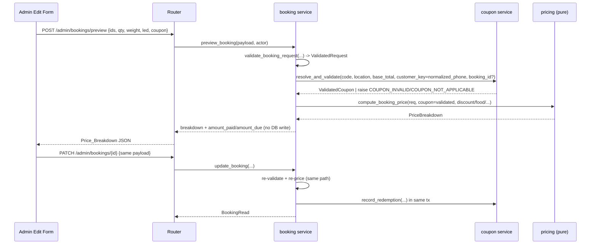
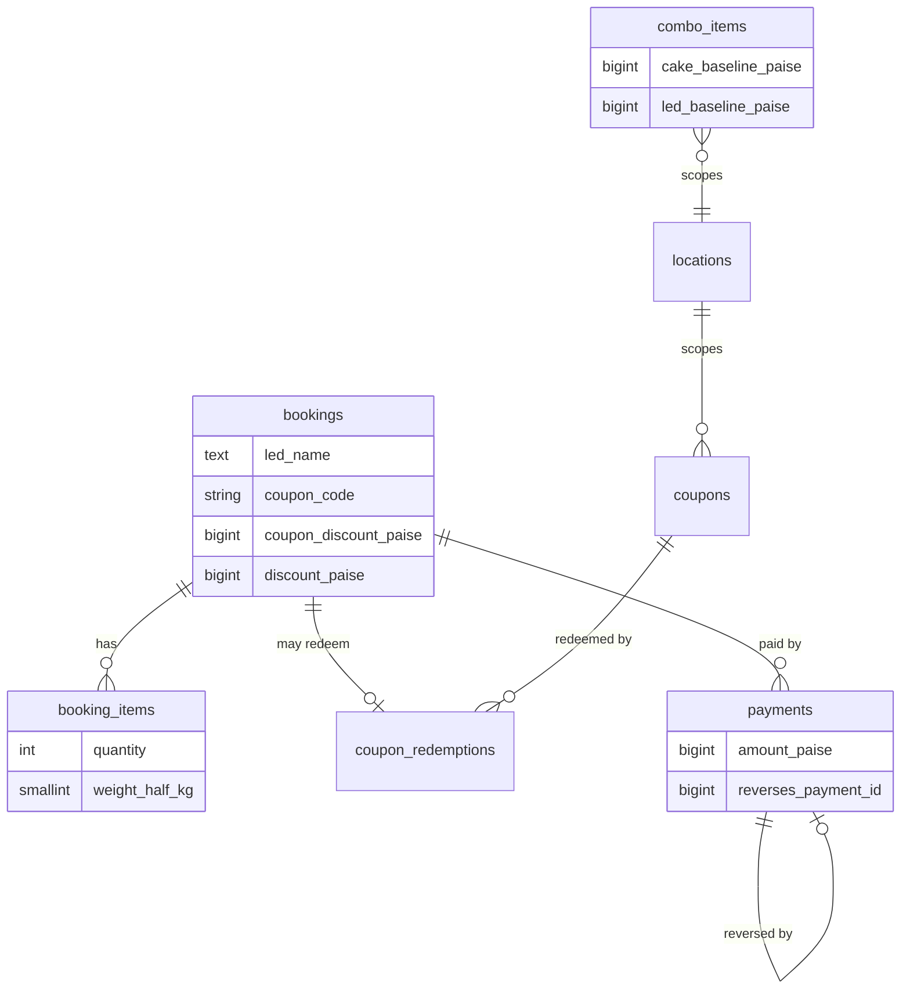

# Design Document: admin-booking-edit

## Overview

This feature adds an admin/staff **Edit booking** capability and extends the booking flow with four new pricing capabilities that apply to both the admin panel and the customer web flow:

1. **Add-on quantity** for `decor` and `combo` lines (cake stays single-select, quantity `1`).
2. **Cake weight pricing** in half-kg steps (`base_price × weight/0.5`).
3. **Admin-managed combos** with optional cake/LED baselines and floored "upgrade delta" pricing.
4. **LED letters** (`4000` paise/letter) persisted on the booking as an `led_name`, priced standalone or through a combo LED delta.
5. **Coupons** — admin-managed, location-scoped `flat`/`percentage` discounts with an optional cap, a configurable base, and selectable usage limits, applied after the admin manual discount.
6. **Contact fields flipped** — **phone becomes mandatory and email optional** on every booking (admin create, Edit_Form, customer web). Phone is normalized to a canonical Indian-mobile form (last 10 digits, starting 6–9), and the coupon per-customer usage limit is keyed on this **Normalized_Phone**.
7. **Payment recording + admin-only void via reversing entry** on the Edit_Form — admin/staff may record one or more payments against a booking (reusing the existing `payments` ledger + `payment_recorded` event), and an **admin** may void a wrong payment by inserting a negative-amount Reversing_Entry that references the original row (never deleting or mutating it). **Amount_Paid/Amount_Due stay derived from the ledger** (`Amount_Paid = SUM(amount_paise)`), so a reversing entry nets the voided payment to zero effect while the ledger remains a complete audit trail.

The guiding invariants from the steering docs are preserved end-to-end: money is integer paise; pricing is a server-authoritative pure function in `services/pricing.py`; the client sends only identifiers, quantities, cake weight, LED text, and a coupon code (never totals or line prices); double-booking is prevented by the DB partial unique index `uq_bookings_active_slot` on `(location_id, plan_id, slot_id, booking_date)`; staff are restricted to their location in the service layer; every state change writes a booking audit event; and all schema changes go through Alembic (sequential revisions after `0002`).

The backend already has `update_booking`, `validate_booking_request`, `_classify_integrity_error`, and a pure `compute_booking_price`. This design extends those rather than replacing them, and adds a coupon service plus a non-persisting preview endpoint.

### Design decisions carried from requirements

- Cake weight is stored in **half-kg integer units** (`weight_half_kg`, where `1 = 0.5 kg`). Justification: the requirement defines weight as a positive multiple of 0.5 kg and prices as `base × (weight/0.5)`; storing half-kg units makes the multiplier exactly the stored integer (`price = base × weight_half_kg`), avoids any float in the DB or pricing, and makes the "multiple of 0.5 kg" constraint a trivial `CHECK >= 1`. A `weight_grams` column would reintroduce the "multiple of 500" validation and a division in pricing for no benefit.
- The add-on request shape moves from parallel ID lists (`special_decor_ids`, `combo_ids`) to **lists of `{id, quantity}` selections** (`special_decor`, `combos`). This is a clean break on the request models (not an additive alias), justified below in [API Design](#api-design).
- Coupon **validation** (location/active/validity/limits) lives in the service layer; the **pure** pricing function receives an already-validated coupon value object. This keeps pricing IO-free and exhaustively property-testable.

## Architecture

Layering is unchanged (`routers -> services -> models`, `integrations` only from services). New work slots into existing layers:

```
Admin React / Astro island
        │ (ids, quantities, cake_weight, led_name, coupon_code — never money)
        ▼
routers/admin/bookings.py        routers/admin/catalog.py (combos +baselines)
  PATCH /bookings/{id}           routers/admin/coupons.py   (NEW, admin-only)
  POST  /bookings/preview (NEW)  routers/public/bookings.py (accepts led/weight/coupon)
        │                        routers/public/preview (NEW, public)
        ▼
services/booking.py  ──────────►  services/coupon.py (NEW: resolve/validate/record)
  validate_booking_request                 │
  update_booking / create_* / preview      ▼
        │                        services/pricing.py (PURE — extended)
        ▼                          compute_booking_price(ValidatedRequest, coupon=...)
models/ (booking, booking_item, combo_item, coupon [NEW], coupon_redemption [NEW])
        ▼
Alembic 0003..0007  (reversible, backfilled)
```

Key flow for an edit preview and save:



## Data Models

All new money columns are `BigInteger` paise. All constraint/index names are explicit per structure.md. Migrations are sequential after `0002`.

### `booking_items` — add quantity and cake weight

| Column | Type | Notes |
|---|---|---|
| `quantity` | `Integer NOT NULL DEFAULT 1` | `CHECK quantity >= 1` named `ck_booking_items_quantity_positive`. Cake lines always `1`. |
| `weight_half_kg` | `SmallInteger NULL` | Half-kg units; `1 = 0.5 kg`. Non-null only for `kind='cake'`. `CHECK (weight_half_kg IS NULL OR weight_half_kg >= 1)` named `ck_booking_items_weight_positive`. |

The existing `ck_booking_items_kind` CHECK is kept unchanged. Backfill (migration `0003`): `UPDATE booking_items SET quantity = 1`; set `weight_half_kg = 1` for `kind='cake'` rows and leave `NULL` for others. Reversible: downgrade drops both columns and both new checks.

Model (`models/booking_item.py`) gains:

```python
quantity: Mapped[int] = mapped_column(Integer, nullable=False, server_default="1")
weight_half_kg: Mapped[int | None] = mapped_column(SmallInteger, nullable=True)
# __table_args__ adds:
#   CheckConstraint("quantity >= 1", name="ck_booking_items_quantity_positive")
#   CheckConstraint("weight_half_kg IS NULL OR weight_half_kg >= 1",
#                   name="ck_booking_items_weight_positive")
```

### `combo_items` — add optional baselines

| Column | Type | Notes |
|---|---|---|
| `cake_baseline_paise` | `BigInteger NULL` | `NULL` ⇒ combo does **not** include a cake. `CHECK (cake_baseline_paise IS NULL OR cake_baseline_paise >= 0)` named `ck_combo_items_cake_baseline_nonneg`. |
| `led_baseline_paise` | `BigInteger NULL` | `NULL` ⇒ combo does **not** include LED. `CHECK (led_baseline_paise IS NULL OR led_baseline_paise >= 0)` named `ck_combo_items_led_baseline_nonneg`. |

Migration `0004` adds both nullable columns + checks. Backfill: none needed (existing combos get `NULL` on both ⇒ no cake/LED component, matching current behaviour where a combo was a flat priced line). Reversible.

### `bookings` — add LED name and applied-coupon snapshot; make `email` nullable

| Column | Type | Notes |
|---|---|---|
| `led_name` | `Text NULL` | The LED text (e.g. "ARUNA"); may be empty/absent. |
| `coupon_code` | `String NULL` | Snapshot of the applied coupon code (`NULL` when none applied). |
| `coupon_discount_paise` | `BigInteger NOT NULL DEFAULT 0` | Server-computed coupon discount. Separate from `discount_paise` (the admin manual discount). |
| `email` | `String NULL` (**altered from NOT NULL**) | Email becomes **optional**. The column is altered from `NOT NULL` to `NULL` so a booking may persist a null email (R22.3, R22.4). |

`discount_paise` (admin manual discount) and `coupon_discount_paise` are **independent columns**; both reduce the total, applied as `… − discount_paise − coupon_discount_paise`. Migration `0005` adds the three new columns **and alters `email` to nullable**; backfill sets `coupon_discount_paise = 0` and leaves `led_name`/`coupon_code` `NULL` (existing non-null emails are untouched). Reversible: downgrade drops the three columns and restores `email` to `NOT NULL` (see the migration note on the email downgrade below).

**Contact-field schema strategy (resolves R22.4–R22.5).** The requirement flips the contact rule: **phone becomes required, email becomes optional**. The chosen strategy:

- **`email` → nullable at the DB level** (altered in migration `0005`). This is a safe widening: making a `NOT NULL` column nullable never fails on existing rows.
- **`phone` is NOT made `NOT NULL` at the DB level.** The `phone` column stays nullable in the database. Phone-required is enforced at the **Pydantic/schema + service layer** (`422 VALIDATION_ERROR` on blank/missing or non-normalizable phone — see [Phone normalization](#phone-normalization-indian-mobile)). Rationale: existing migrated/legacy rows may have a null phone, so a hard `NOT NULL` on `phone` would fail the migration (the exact concern R22.5 flags). API-layer validation is sufficient, is reversible, and matches how the system validates every other input (all request bodies are validated Pydantic models; the client never bypasses them). A future migration could backfill phones and then tighten to a DB `NOT NULL` constraint once legacy rows are cleaned — noted as optional future work, not required here.
- **Storage of the normalized phone.** We store the **raw phone as entered** (the existing `phone` column) for display, and **normalize on demand** when building the coupon `customer_key`. Rationale: the booking already carries the `phone` column, normalization is a cheap pure function, and this avoids adding a second column or a backfill migration for a derived value. (A dedicated `normalized_phone` column was considered but rejected as unnecessary at this scale — tens of bookings/day — and it would require keeping two columns in sync on every write.)

The `email`-downgrade note: because downgrade restores `NOT NULL`, any rows that were persisted with a null email after the upgrade must be backfilled (e.g. to `''`) inside `downgrade()` before re-adding the constraint, so the downgrade cannot fail. The migration documents this so the reversal is safe.

Model change (`models/booking.py`): the `email` mapped column changes from `Mapped[str]` / `nullable=False` to `Mapped[str | None]` / `nullable=True`. The `phone` column already is `Mapped[str | None]` / `nullable=True` and is **left unchanged at the model/DB level** (phone-required is a schema/service rule, per the strategy above).

### `coupons` — new table (migration `0006`)

| Column | Type | Notes |
|---|---|---|
| `id` | `BigInteger identity PK` | |
| `location_id` | `BigInteger FK locations(id) ON DELETE RESTRICT NOT NULL` | indexed `ix_coupons_location_id`. `RESTRICT` so a location with coupons can't be silently deleted. |
| `code` | `String NOT NULL` | |
| `type` | `String NOT NULL` | `CHECK (type IN ('flat','percentage'))` named `ck_coupons_type`. |
| `value` | `BigInteger NOT NULL` | For `flat`: discount in **paise**. For `percentage`: an **integer percent 0–100** (not paise). `CHECK (value >= 0)` named `ck_coupons_value_nonneg`; percentage range (`<= 100`) is enforced in the service/schema since it is type-dependent. |
| `cap_paise` | `BigInteger NULL` | Max discount for `percentage`; `NULL` = uncapped. `CHECK (cap_paise IS NULL OR cap_paise >= 0)` named `ck_coupons_cap_nonneg`. |
| `percentage_base` | `String NOT NULL DEFAULT 'total'` | `CHECK (percentage_base IN ('total','selected_components'))` named `ck_coupons_percentage_base`. |
| `components` | `JSONB NULL` | Which components are included when `percentage_base='selected_components'`. See representation below. |
| `effective_from` | `Date NULL` | validity window start (`NULL` = no lower bound). |
| `effective_to` | `Date NULL` | validity window end (`NULL` = no upper bound). |
| `is_active` | `Boolean NOT NULL DEFAULT true` | |
| `one_time` | `Boolean NOT NULL DEFAULT false` | one-time use across the whole system. |
| `total_usage_limit` | `Integer NULL` | max total redemptions; `NULL` = unlimited. |
| `per_customer_limit` | `Integer NULL` | max redemptions per customer identity; `NULL` = unlimited. |
| `min_order_paise` | `BigInteger NULL` | minimum pre-coupon total to qualify; `NULL` = no minimum. |
| `created_at` / `updated_at` | `timestamptz` | via `TimestampMixin`. |

**Component representation (`components` JSONB):** a flat object of booleans keyed by the fixed component set, e.g. `{"plan": true, "extra_guest": false, "decor": true, "combos": true, "cake": false, "food": false}`. Justification: the component set is small, fixed, and admin-authored once; a JSONB object is self-describing, needs no join table or extra migration when a component is added, and reads trivially into the pricing value object. It is `NULL`/ignored when `percentage_base='total'`. A set of boolean columns was considered but rejected: it bloats the table with rarely-used columns and forces a migration per component.

**Uniqueness:** a **plain unique index on `(location_id, code)`** named `uq_coupons_location_code`. Justification: codes should be unique per location regardless of active state so re-activating or editing an old coupon can't collide with a live one, and lookups resolve a code within a location deterministically. A partial unique on active rows was considered but rejected because it would allow two coupons to share a code (one active, one inactive), which makes the "resolve code within location" lookup ambiguous when the admin toggles `is_active`.

### `coupon_redemptions` — new table (migration `0007`)

Tracks usage to enforce `one_time`, `total_usage_limit`, and `per_customer_limit`.

| Column | Type | Notes |
|---|---|---|
| `id` | `BigInteger identity PK` | |
| `coupon_id` | `BigInteger FK coupons(id) ON DELETE CASCADE NOT NULL` | indexed `ix_coupon_redemptions_coupon_id`. |
| `booking_id` | `BigInteger FK bookings(id) ON DELETE CASCADE NOT NULL` | one redemption per booking; `uq_coupon_redemptions_booking` unique on `booking_id` so re-editing the same booking doesn't double-count. |
| `customer_key` | `String NOT NULL` | the booking's **Normalized_Phone** (canonical last-10-digit Indian mobile) — see below. indexed `ix_coupon_redemptions_customer` on `(coupon_id, customer_key)`. |
| `discount_paise` | `BigInteger NOT NULL` | the discount granted at redemption time. |
| `created_at` | `timestamptz NOT NULL DEFAULT now()` | |

**Per-customer keying.** Customers are not authenticated users. We key per-customer on the booking's **Normalized_Phone** — the canonical last-10-digit Indian mobile produced by `normalize_indian_mobile` (see [Phone normalization](#phone-normalization-indian-mobile)). Since phone is now mandatory and normalized, every booking has a well-defined customer key; per-customer limits count **distinct Normalized_Phone values**. A customer who types their number under different formats (`"+91 98765 43210"`, `"098765 43210"`, `"9876543210"`) normalizes to one key and so counts **once** (R23.5). Documented behaviour (not a limitation): two **different actual phone numbers** are two different customers — this is intended, and is the correct identity for this system's scale (tens of bookings/day, 3 branches). The booking service computes the Normalized_Phone from the booking's stored `phone` and passes it as `customer_key`, keeping the coupon service agnostic of the booking shape.

**Count semantics.** `total_usage_limit` compares against `COUNT(*)` of redemptions for the coupon. `per_customer_limit` compares against `COUNT(*)` where `customer_key` matches. `one_time` is equivalent to `total_usage_limit = 1`. Because `coupon_redemptions.booking_id` is unique, editing a booking that already redeemed the coupon updates (upserts) its own row rather than inserting a second, so an edit never consumes a second use of the same coupon for the same booking.

### `payments` — allow reversing entries (migration `0008`)

The existing `payments` ledger is extended so a payment can be voided by inserting a **negative-amount Reversing_Entry** that references the original row (R25, R26). The table is append-only: voiding never mutates or deletes the original Payment_Entry; `Amount_Paid = SUM(amount_paise)` naturally nets a voided payment to zero.

| Column | Type | Notes |
|---|---|---|
| `amount_paise` | `BigInteger NOT NULL` | **CHECK relaxed** from `amount_paise > 0` to `amount_paise <> 0` so a Reversing_Entry may be negative while a zero amount stays rejected (R26.1). The check is **renamed** `ck_payments_amount_positive` → `ck_payments_amount_nonzero` for accuracy: migration `0008` drops the old check and adds the new one under the new name. |
| `reverses_payment_id` | `BigInteger NULL` | **NEW.** Self-referencing FK → `payments.id`, `ON DELETE RESTRICT` (named `fk_payments_reverses_payment_id`), indexed `ix_payments_reverses_payment_id`. `NULL` for a normal Payment_Entry; set to the original payment's id on a Reversing_Entry (R25.1, R26.2). `RESTRICT` so an original payment that has been reversed cannot be deleted out from under its reversal. |

The existing `method`/`amount_paise`/`received_at`/`recorded_by_user_id`/`provider`/`provider_ref`/`note` columns and the `ck_payments_method` check are unchanged. A Reversing_Entry reuses these columns: `method` **mirrors the original payment's method** (documented choice — see the void service), `note` carries the void reason, `recorded_by_user_id` is the acting admin, and `amount_paise = −original.amount_paise`.

Model (`models/payment.py`) gains the self-FK and the renamed check:

```python
reverses_payment_id: Mapped[int | None] = mapped_column(
    ForeignKey("payments.id", ondelete="RESTRICT", name="fk_payments_reverses_payment_id"),
    nullable=True,
    index=True,  # ix_payments_reverses_payment_id
)
# __table_args__ changes:
#   - REMOVE CheckConstraint("amount_paise > 0", name="ck_payments_amount_positive")
#   + ADD    CheckConstraint("amount_paise <> 0", name="ck_payments_amount_nonzero")
#   (ck_payments_method is kept unchanged)
```

### `booking_events` — add `payment_voided` to the type CHECK (migration `0009`)

The `booking_events` allowed-type CHECK (`ck_booking_events_type`) currently lists `created, accepted, rejected, edited, payment_recorded, expired`. Voiding writes a new `payment_voided` audit event, so the list must include it (R25.9, R26.3).

| Constraint | Change |
|---|---|
| `ck_booking_events_type` | **Rebuilt** to `event_type IN ('created','accepted','rejected','edited','payment_recorded','payment_voided','expired')`. A CHECK cannot be altered in place, so migration `0009` drops and re-adds it under the same name. |

Model (`models/booking_event.py`): add `"payment_voided"` to `BOOKING_EVENT_TYPES` and to the `CheckConstraint` expression (same `ck_booking_events_type` name).

### Entity relationships



### Migration list (ordered after 0002)

| Rev | Message | Change | Backfill |
|---|---|---|---|
| `0003` | `add_quantity_and_cake_weight_to_booking_items` | `quantity`, `weight_half_kg` + 2 checks | `quantity=1` all rows; `weight_half_kg=1` for cake rows |
| `0004` | `add_cake_led_baselines_to_combo_items` | `cake_baseline_paise`, `led_baseline_paise` + 2 checks | none (NULL = no component) |
| `0005` | `add_led_name_coupon_snapshot_and_nullable_email_to_bookings` | `led_name`, `coupon_code`, `coupon_discount_paise`; **alter `email` → nullable** | `coupon_discount_paise=0` (downgrade backfills null emails to `''` before restoring `NOT NULL`) |
| `0006` | `create_coupons_table` | `coupons` + checks + `uq_coupons_location_code` + `ix_coupons_location_id` | none |
| `0007` | `create_coupon_redemptions_table` | `coupon_redemptions` + FKs + unique/indexes | none |
| `0008` | `relax_payments_amount_check_and_add_reverses_fk` | drop `ck_payments_amount_positive`; add `ck_payments_amount_nonzero` (`amount_paise <> 0`); add `reverses_payment_id` self-FK (`fk_payments_reverses_payment_id`, `ON DELETE RESTRICT`) + `ix_payments_reverses_payment_id` | none |
| `0009` | `add_payment_voided_booking_event_type` | rebuild `ck_booking_events_type` to include `payment_voided` (drop + re-add under same name) | none |

Every `downgrade()` drops exactly what its `upgrade()` added, in reverse order (indexes/checks before columns/tables). The quantity/weight backfill is forward-only data; downgrade simply drops the columns, so no data-loss ambiguity like `0002`'s index-tightening exists.

**`0008` downgrade note (documented precedent — like `0002`).** The upgrade is a pure widening (`<> 0` admits every row `> 0` already satisfies), so it never fails. The **downgrade** drops `ix_payments_reverses_payment_id`, the `fk_payments_reverses_payment_id` FK, and the `reverses_payment_id` column, then drops `ck_payments_amount_nonzero` and re-adds `ck_payments_amount_positive` (`amount_paise > 0`). Re-adding the stricter `> 0` check **can only succeed if no negative (reversing) rows exist**; the migration documents this constraint explicitly — exactly the `0002` precedent where tightening a constraint on downgrade requires the data to already satisfy it. (Dropping `reverses_payment_id` first removes the only way a negative row could have been created, but any negative rows already persisted must be removed before the downgrade can re-add `> 0`.)

**`0009` downgrade note.** The upgrade drops and re-adds `ck_booking_events_type` with `payment_voided` added. The downgrade restores the prior list (`created, accepted, rejected, edited, payment_recorded, expired`); re-adding the narrower CHECK **can only succeed if no `payment_voided` rows exist**. The migration documents this (same tightening-on-downgrade precedent as `0002`/`0008`): any `payment_voided` audit rows must be removed before the downgrade can restore the narrower constraint.

## Pricing Algorithm (server-authoritative, pure)

`services/pricing.py` stays a pure function of already-validated value objects — no DB, no IO. Coupon *validation* happens in the service layer first; pricing receives an already-validated coupon value object (or `None`).

### Extended value objects

```python
LED_UNIT_PRICE_PAISE = 4000  # single documented constant; ₹40/letter


def led_letter_count(led_name: str | None) -> int:
    """A–Z only, case-insensitive, ignoring spaces/punctuation. '' / None -> 0."""
    if not led_name:
        return 0
    return sum(1 for ch in led_name if ch.isascii() and ch.isalpha())


@dataclass(frozen=True)
class DecorSelection:
    item: SpecialDecorItem
    quantity: int  # >= 1


@dataclass(frozen=True)
class ComboSelection:
    item: ComboItem            # carries cake_baseline_paise / led_baseline_paise (nullable)
    # quantity is always 1 for combos (not stored)


@dataclass(frozen=True)
class ValidatedCoupon:
    code: str
    type: str                  # 'flat' | 'percentage'
    value: int                 # flat: paise; percentage: integer percent 0..100
    cap_paise: int | None
    percentage_base: str       # 'total' | 'selected_components'
    components: frozenset[str]  # subset of COMPONENT_KEYS when base == selected_components


@dataclass(frozen=True)
class ValidatedRequest:
    plan: Plan
    people: int
    cake: Cake | None = None
    cake_weight_half_kg: int = 1          # NEW; default 1 == 0.5 kg
    special_decor: list[DecorSelection] = field(default_factory=list)  # was list[SpecialDecorItem]
    combos: list[ComboSelection] = field(default_factory=list)         # was list[ComboItem]
    led_name: str | None = None           # NEW


@dataclass(frozen=True)
class AddonLine:
    kind: str                 # 'cake' | 'decor' | 'combo' | 'led'
    item_id: int | None       # None for the standalone LED line
    name_snapshot: str
    unit_price_paise: int     # NEW: per-unit price snapshot
    quantity: int             # 1 for cake/combo/led; >= 1 for decor
    weight_half_kg: int | None  # NEW: set only for the cake line (half-kg units)

    @property
    def amount_paise(self) -> int:
        """Line amount. Cake uses the weighted price; others use unit × qty.

        For a cake line the weight multiplier is the stored half-kg integer, so
        amount = unit_price_paise × weight_half_kg (quantity is always 1). For
        decor/combo/led, amount = unit_price_paise × quantity.
        """
        if self.kind == "cake":
            return self.unit_price_paise * (self.weight_half_kg or 1)
        return self.unit_price_paise * self.quantity
```

Note on the LED line: the standalone LED `AddonLine` uses `item_id=None`,
`kind='led'`, `quantity=1`, and `unit_price_paise = LED_Letter_Count × LED_UNIT_PRICE_PAISE`
(the whole LED charge is the "unit price"; it is not re-multiplied). `name_snapshot`
captures the LED text so the ledger and Edit_Form can show what was ordered.

### `PriceBreakdown` (extended)

```python
# COMPONENT_KEYS fixes the vocabulary for coupon 'selected_components' bases and
# for mapping each key to a concrete amount (see compute_coupon_discount).
COMPONENT_KEYS = frozenset(
    {"plan", "extra_guest", "decor", "combos", "cake", "food"}
)


@dataclass(frozen=True)
class PriceBreakdown:
    plan_price_paise: int
    extra_guest_paise: int
    addon_lines: list[AddonLine]       # decor + combo + (cake | nothing) + (led | nothing)
    subtotal_paise: int                # plan + extra_guest + sum(addon amounts)
    discount_paise: int                # admin manual discount (0 for customers)
    food_paise: int
    other_paise: int
    cleaning_paise: int
    coupon_code: str | None            # NEW: applied code snapshot (None if none)
    coupon_discount_paise: int         # NEW: server-computed, >= 0
    total_paise: int                   # max(0, subtotal + food + other + cleaning
                                       #        - discount - coupon_discount)
```

`amount_paid_paise` and `amount_due_paise` are **not** part of `PriceBreakdown`.
They are *derived* from the payments ledger (`services.payments.derive_amounts_for_booking`),
not from pricing, and are attached alongside the breakdown by the router/service
when assembling a `BookingRead` or a preview response. This keeps pricing a pure
function with no knowledge of payments: `amount_due_paise = total_paise − amount_paid_paise`
and may be negative when overpaid (never clamped). *(R2.1, R6.3)*

### The `compute_booking_price` algorithm

Pricing receives a `ValidatedRequest` (plan, people, cake, `cake_weight_half_kg`,
`special_decor` selections with quantity, `combos` selections, `led_name`), the
admin money fields, `is_customer`, and an optional already-validated
`ValidatedCoupon`. It is pure and IO-free. Steps run **in this order**:

```python
def compute_booking_price(
    req: ValidatedRequest,
    *,
    discount_paise: int = 0,
    food_paise: int = 0,
    other_paise: int = 0,
    cleaning_paise: int = 0,
    is_customer: bool,
    coupon: ValidatedCoupon | None = None,
) -> PriceBreakdown:

    plan = req.plan

    # 1. Plan price + extra-guest charge (rates come from the plan row).
    extra_guest = max(0, req.people - plan.people_allowed) * plan.extra_guest_paise

    lines: list[AddonLine] = []

    # Precompute the two "variable" values combos may absorb:
    #   chosen cake weighted price, and the standalone LED charge.
    cake_weighted = (
        req.cake.price_paise * req.cake_weight_half_kg if req.cake else 0
    )
    led_count = led_letter_count(req.led_name)
    led_charge = led_count * LED_UNIT_PRICE_PAISE

    # Determine whether ANY selected combo absorbs cake / LED.
    combo_covers_cake = any(
        c.item.cake_baseline_paise is not None for c in req.combos
    )
    combo_covers_led = any(
        c.item.led_baseline_paise is not None for c in req.combos
    )

    # 2. Decor lines: unit_price × quantity.
    for d in req.special_decor:
        lines.append(AddonLine(
            kind="decor", item_id=d.item.id, name_snapshot=d.item.name,
            unit_price_paise=d.item.price_paise, quantity=d.quantity,
            weight_half_kg=None,
        ))

    # 3. Cake handling.
    #    If a selected combo has a cake baseline, the cake is priced THROUGH that
    #    combo's cake delta (step 5) — NO standalone cake line here (R14.6).
    #    Else emit a standalone weighted cake line (R12.1, R14.7).
    if req.cake is not None and not combo_covers_cake:
        lines.append(AddonLine(
            kind="cake", item_id=req.cake.id, name_snapshot=req.cake.description,
            unit_price_paise=req.cake.price_paise, quantity=1,
            weight_half_kg=req.cake_weight_half_kg,   # amount = base × weight_half_kg
        ))

    # 4. LED handling.
    #    If a selected combo has an LED baseline, LED is priced THROUGH that
    #    combo's LED delta (step 5) — NO standalone LED line (R14.8).
    #    Else, if there are letters, emit a standalone LED line (R16.4).
    if led_count > 0 and not combo_covers_led:
        lines.append(AddonLine(
            kind="led", item_id=None, name_snapshot=req.led_name or "",
            unit_price_paise=led_charge, quantity=1, weight_half_kg=None,
        ))

    # 5. Combo lines: combo_price
    #       + max(0, chosen_cake_weighted − cake_baseline)  [if cake baseline]
    #       + max(0, led_charge − led_baseline)             [if led baseline]
    for c in req.combos:
        combo_amount = c.item.price_paise
        if c.item.cake_baseline_paise is not None:
            combo_amount += max(0, cake_weighted - c.item.cake_baseline_paise)
        if c.item.led_baseline_paise is not None:
            combo_amount += max(0, led_charge - c.item.led_baseline_paise)
        lines.append(AddonLine(
            kind="combo", item_id=c.item.id, name_snapshot=c.item.name,
            unit_price_paise=combo_amount, quantity=1, weight_half_kg=None,
        ))

    # 6. Subtotal = plan + extra_guest + sum(addon amounts).
    addon_total = sum(line.amount_paise for line in lines)
    subtotal = plan.price_paise + extra_guest + addon_total

    # 7. Admin manual discount: clamped to [0, plan.max_discount_paise], 0 when
    #    the plan disallows discounts, and always 0 for customers (unchanged rule).
    discount = _resolve_discount(plan, discount_paise, is_customer)
    food, other, cleaning = max(0, food_paise), max(0, other_paise), max(0, cleaning_paise)

    # 8. Pre-coupon total.
    total_before_coupon = subtotal + food + other + cleaning - discount

    # 9. Coupon discount (coupon already validated by the service layer).
    coupon_discount = 0
    coupon_code = None
    if coupon is not None:
        coupon_code = coupon.code
        coupon_discount = compute_coupon_discount(
            coupon,
            total_before_coupon=total_before_coupon,
            plan_price=plan.price_paise,
            extra_guest=extra_guest,
            decor_total=sum(l.amount_paise for l in lines if l.kind == "decor"),
            combo_total=sum(l.amount_paise for l in lines if l.kind == "combo"),
            cake_total=sum(l.amount_paise for l in lines if l.kind == "cake"),
            food=food,
        )

    # 10. Total, clamped at 0 so a coupon can never make it negative (R20.4).
    total = max(0, total_before_coupon - coupon_discount)

    return PriceBreakdown(
        plan_price_paise=plan.price_paise, extra_guest_paise=extra_guest,
        addon_lines=lines, subtotal_paise=subtotal, discount_paise=discount,
        food_paise=food, other_paise=other, cleaning_paise=cleaning,
        coupon_code=coupon_code, coupon_discount_paise=coupon_discount,
        total_paise=total,
    )
```

### Coupon discount computation (pure)

```python
import math


def compute_coupon_discount(
    coupon: ValidatedCoupon,
    *,
    total_before_coupon: int,
    plan_price: int,
    extra_guest: int,
    decor_total: int,
    combo_total: int,
    cake_total: int,
    food: int,
) -> int:
    if coupon.type == "flat":
        # Flat coupons subtract a fixed paise value (never below 0; the final
        # total is clamped in compute_booking_price).
        return max(0, coupon.value)

    # percentage: value is an integer percent 0..100.
    if coupon.percentage_base == "total":
        base = max(0, total_before_coupon)
    else:  # 'selected_components' — sum ONLY the configured component amounts.
        component_amounts = {
            "plan": plan_price,
            "extra_guest": extra_guest,
            "decor": decor_total,
            "combos": combo_total,
            "cake": cake_total,
            "food": food,
        }
        base = sum(component_amounts[k] for k in coupon.components)

    raw = _round_half_up(coupon.value * base, 100)   # round(pct/100 × base) in paise
    if coupon.cap_paise is not None:
        return min(coupon.cap_paise, raw)
    return raw


def _round_half_up(numerator: int, denominator: int) -> int:
    """Integer round-half-up of numerator/denominator (both positive)."""
    return (numerator + denominator // 2) // denominator
```

**Component-to-amount mapping (percentage `selected_components`).** The six
configurable component keys map to exactly these breakdown amounts:

| Key | Amount summed into the base |
|---|---|
| `plan` | `plan_price_paise` |
| `extra_guest` | `extra_guest_paise` (the extra-member charge) |
| `decor` | sum of all **decor** line amounts (unit × quantity) |
| `combos` | sum of all **combo** line amounts (combo price + absorbed cake/LED deltas) |
| `cake` | the standalone weighted **cake** line amount (`0` when the cake is absorbed by a combo) |
| `food` | `food_paise` |

`other` and `cleaning` are intentionally **not** eligible component keys (they
are not in the requirement's component set); they only ever affect a `total`-based
coupon through the pre-coupon total. *(R20.3)*

**Rounding decision (documented).** Percentage coupons round **half up** to the
nearest integer paise: `discount = (value × base + 50) // 100`. Rationale:
half-up is the conventional monetary rounding, is deterministic, and keeps the
discount an exact integer paise with no float involvement. The cap (when present)
is applied **after** rounding: `min(cap, round_half_up(...))`.

### Combo / cake and combo / LED interaction (no double-counting)

The cake and LED each contribute to the total through **exactly one** path:

- **Cake:** if any selected combo declares a `cake_baseline_paise`, the chosen
  cake is priced *only* via that combo's `max(0, cake_weighted − baseline)`
  delta and **no** standalone cake line is emitted (R14.6). Otherwise the cake
  is a standalone weighted line (R14.7, R12).
- **LED:** if any selected combo declares a `led_baseline_paise`, LED is priced
  *only* via that combo's `max(0, led_charge − baseline)` delta and **no**
  standalone LED line is emitted (R14.8). Otherwise LED is a standalone
  `letters × 4000` line (R14.9, R16.4).

**Multiple combos declaring a baseline — design decision.** If two or more
selected combos each declare a cake baseline (or each declare an LED baseline),
the chosen cake/LED is ambiguous: which combo "absorbs" it? **Decision: disallow
more than one cake-baseline combo per booking, and likewise more than one
LED-baseline combo per booking.** The service-layer validation
(`validate_booking_request`) rejects such a selection with `422 ITEM_INVALID`
("Only one combo may include a cake" / "Only one combo may include LED"). This
is the simplest defensible rule: it removes the ambiguity entirely, keeps the
pricing function total and order-independent, and matches the real product
(a booking has at most one cake and one LED name). The pricing function itself
is written defensively (it would absorb the cake into whichever combo it
iterates, but the service guarantees at most one), so pricing stays confluent.
This is recorded as a resolved design decision, not an open question.

## API Design

All request/response bodies are Pydantic v2 models, `snake_case`, money in
integer paise. Admin routes keep the router-level
`Depends(require_role("admin","staff"))` + `Depends(check_origin)`; coupon/combo
*authoring* additionally requires `require_role("admin")`. Public routes are an
explicit allowlist with no auth.

### Shared selection + breakdown schemas

```python
class DecorSelectionIn(BaseModel):
    id: int
    quantity: int = Field(ge=1)          # R5.6: < 1 or non-int -> 422 VALIDATION_ERROR

class ComboSelectionIn(BaseModel):
    id: int                               # combo quantity is always 1 (not accepted)

class AddonLineRead(BaseModel):
    kind: str                             # 'cake' | 'decor' | 'combo' | 'led'
    item_id: int | None
    name_snapshot: str
    unit_price_paise: int
    quantity: int
    weight_half_kg: int | None            # set only for the cake line
    amount_paise: int                     # server-computed line amount

class PriceBreakdownRead(BaseModel):
    plan_price_paise: int
    extra_guest_paise: int
    addon_lines: list[AddonLineRead]
    subtotal_paise: int
    discount_paise: int
    food_paise: int
    other_paise: int
    cleaning_paise: int
    coupon_code: str | None
    coupon_discount_paise: int
    total_paise: int
    amount_paid_paise: int                # derived from payments ledger
    amount_due_paise: int                 # total − paid; may be negative
```

### Preview endpoints (compute, never persist) — R6, R5.D5

Two preview endpoints share one request shape minus the admin money fields.

```python
class PreviewBase(BaseModel):
    location_id: int
    plan_id: int
    slot_id: int
    booking_date: date
    people: int = Field(ge=1)
    cake_id: int | None = None
    cake_weight_half_kg: int = Field(default=1, ge=1)   # 1 == 0.5 kg
    special_decor: list[DecorSelectionIn] = Field(default_factory=list)
    combos: list[ComboSelectionIn] = Field(default_factory=list)
    led_name: str | None = None
    occasion_id: int | None = None
    coupon_code: str | None = None

class AdminPreviewRequest(PreviewBase):
    # admin may preview the effect of money fields; customer preview may not.
    discount_paise: int = Field(default=0, ge=0)
    food_paise: int = Field(default=0, ge=0)
    other_paise: int = Field(default=0, ge=0)
    cleaning_paise: int = Field(default=0, ge=0)

class PublicPreviewRequest(PreviewBase):
    pass    # NO money fields; discount is forced to 0 server-side (is_customer=True)
```

- `POST /api/v1/admin/bookings/preview` → `PriceBreakdownRead`.
  Deps: router-level `require_role("admin","staff")` + `check_origin`. The
  service validates items (location/date/role), resolves+validates the coupon
  (without recording a redemption), and returns the breakdown. **No DB write.**
  Staff outside the location → `403` (R6.6). Invalid id/quantity → `422` (R6.5).
- `POST /api/v1/public/bookings/preview` → `PriceBreakdownRead`.
  No auth (public allowlist), rate-limited like other public booking calls.
  `is_customer=True` forces `discount_paise=0`; admin money fields are not
  accepted. Coupon code is accepted and validated. **No DB write.** Used by the
  customer web booking island for its live summary (R17.2, R18.2, R20.1).

A preview may reference an existing booking so coupon usage limits exclude that
booking's own redemption; the admin preview optionally accepts `booking_id` for
this (used when previewing an edit). When absent (create preview), no booking is
excluded.

### Changed create/edit request models (breaking change) — R10

The add-on request shape changes from parallel ID lists to `{id, quantity}`
selection lists, and gains cake weight, LED text, and coupon code. This is a
**breaking change** to the request contract: `special_decor_ids` / `combo_ids`
are replaced (not aliased) by `special_decor` / `combos`. The admin React client,
the customer web island, and the generated TypeScript types
(`openapi-typescript` → `apps/admin/src/api/schema.ts`) must all be regenerated
and updated together (R10.1–R10.3). The admin zod schema mirrors the server
rules (quantity ≥ 1, non-negative money fields, **phone required / email
optional** — R22.6).

**Contact-field rule across all booking schemas (R22, R23).** `BookingCreate`,
`AdminBookingCreate` (via inheritance), and `BookingUpdate` make `phone`
**required and non-empty**, validated as a normalizable Indian mobile, and make
`email` **optional** (`str | None`). `phone` is typed `str` with
`Field(min_length=1)` and a `field_validator` that runs
`normalize_indian_mobile` and raises (→ `422 VALIDATION_ERROR`) when it returns
`None`; the schema accepts the raw string (the raw value is stored), while the
validator guarantees it normalizes. On `BookingUpdate`, `phone` stays `str | None`
with `None` meaning "unchanged" per the PATCH convention, but when **present** it
is validated the same way (a present blank/invalid phone → `422`). The admin and
customer-web **zod** schemas mirror this exactly (phone required + Indian-mobile
pattern, email optional) per R22.6.

```python
class BookingCreate(BaseModel):          # public customer create (no money fields)
    location_id: int
    plan_id: int
    slot_id: int
    booking_date: date
    booking_name: str
    phone: str = Field(min_length=1)     # REQUIRED; validated as Indian mobile below
    email: str | None = None             # CHANGED: optional (was required)
    special_person_name: str | None = None
    name_on_cake: str | None = None
    message: str | None = None
    people: int = Field(ge=1)
    occasion_id: int | None = None
    cake_id: int | None = None
    cake_weight_half_kg: int = Field(default=1, ge=1)   # NEW
    special_decor: list[DecorSelectionIn] = Field(default_factory=list)  # CHANGED
    combos: list[ComboSelectionIn] = Field(default_factory=list)         # CHANGED
    led_name: str | None = None          # NEW
    coupon_code: str | None = None       # NEW

    @field_validator("phone")
    @classmethod
    def _valid_indian_mobile(cls, v: str) -> str:
        # blank already rejected by min_length=1; non-normalizable -> 422
        if normalize_indian_mobile(v) is None:
            raise ValueError("phone must be a valid Indian mobile number")  # 422 VALIDATION_ERROR
        return v                          # store the raw value; normalize on demand

class AdminBookingCreate(BookingCreate):  # adds admin money fields
    discount_paise: int = Field(default=0, ge=0)
    food_paise: int = Field(default=0, ge=0)
    other_paise: int = Field(default=0, ge=0)
    cleaning_paise: int = Field(default=0, ge=0)

class BookingUpdate(BaseModel):          # PATCH — all optional; omitted = unchanged
    people: int | None = Field(default=None, ge=1)
    occasion_id: int | None = None
    cake_id: int | None = None
    cake_weight_half_kg: int | None = Field(default=None, ge=1)   # NEW
    special_decor: list[DecorSelectionIn] | None = None          # CHANGED
    combos: list[ComboSelectionIn] | None = None                 # CHANGED
    led_name: str | None = None          # NEW
    coupon_code: str | None = None       # NEW
    discount_paise: int | None = Field(default=None, ge=0)
    food_paise: int | None = Field(default=None, ge=0)
    other_paise: int | None = Field(default=None, ge=0)
    cleaning_paise: int | None = Field(default=None, ge=0)
    booking_name: str | None = None
    phone: str | None = None             # None = unchanged; if present, must be a valid Indian mobile
    email: str | None = None             # None = unchanged; email remains optional
    special_person_name: str | None = None
    name_on_cake: str | None = None
    message: str | None = None

    @field_validator("phone")
    @classmethod
    def _valid_indian_mobile_if_present(cls, v: str | None) -> str | None:
        if v is None:
            return None                   # unchanged
        if not v.strip() or normalize_indian_mobile(v) is None:
            raise ValueError("phone must be a valid Indian mobile number")  # 422 VALIDATION_ERROR
        return v
```

> **PATCH caveat for lists.** Because `None` means "unchanged" for PATCH, a
> client clearing all decor/combos must send `[]` (empty list), not omit the
> field. `led_name`/`coupon_code` use `None`=unchanged; an explicit empty string
> clears LED, and clearing a coupon is modeled by sending `coupon_code: ""`
> (treated as "remove coupon"), consistent with the existing optional-field
> convention. This is documented so the Edit_Form sends full selection lists.

### `BookingRead` / detail response — R2, R20.7

`BookingRead` gains the add-on lines with `quantity` + `weight_half_kg`,
`led_name`, `coupon_code` + `coupon_discount_paise`, the full breakdown fields,
and the derived `amount_paid_paise` / `amount_due_paise` so the Edit_Form can
pre-fill everything in one call.

```python
class BookingItemRead(BaseModel):        # extended
    kind: str
    item_id: int | None
    name_snapshot: str
    price_paise: int                     # the stored unit price snapshot
    quantity: int                        # NEW
    weight_half_kg: int | None           # NEW (cake only)

class BookingRead(BaseModel):            # extended (existing fields kept)
    # ... all existing fields ...
    phone: str                           # always present (phone is now mandatory)
    email: str | None                    # CHANGED: optional (null when the booking has no email)
    led_name: str | None                 # NEW
    coupon_code: str | None              # NEW
    coupon_discount_paise: int           # NEW
    items: list[BookingItemRead]
    # amount_paid_paise / amount_due_paise already present (derived)
```

### Admin coupon CRUD — `routers/admin/coupons.py` (admin-only) — R19

A new admin router, mounted under the admin prefix, following the existing
catalog-router pattern (router-level `require_role("admin")` so every coupon
authoring endpoint is admin-only by default; non-admin → `403`, R19.5).

```python
class CouponComponents(BaseModel):       # only meaningful for selected_components
    plan: bool = False
    extra_guest: bool = False
    decor: bool = False
    combos: bool = False
    cake: bool = False
    food: bool = False

class CouponBase(BaseModel):
    code: str
    type: Literal["flat", "percentage"]
    value: int = Field(ge=0)             # flat: paise; percentage: 0..100 (validated)
    cap_paise: int | None = Field(default=None, ge=0)
    percentage_base: Literal["total", "selected_components"] = "total"
    components: CouponComponents | None = None
    effective_from: date | None = None
    effective_to: date | None = None
    is_active: bool = True
    one_time: bool = False
    total_usage_limit: int | None = Field(default=None, ge=1)
    per_customer_limit: int | None = Field(default=None, ge=1)
    min_order_paise: int | None = Field(default=None, ge=0)

    @model_validator(mode="after")
    def _check(self) -> "CouponBase":
        if self.type == "percentage" and not (0 <= self.value <= 100):
            raise ValueError("percentage value must be 0..100")   # -> 422 (R19.6)
        return self

class CouponCreate(CouponBase):
    location_id: int

class CouponUpdate(CouponBase):          # full replace of editable fields
    pass

class CouponRead(CouponBase):
    id: int
    location_id: int
```

- `POST   /api/v1/admin/coupons` → `CouponRead` (201). Create (R19.1).
- `PATCH  /api/v1/admin/coupons/{id}` → `CouponRead`. Edit (R19.2).
- `GET    /api/v1/admin/coupons?location_id=` → `list[CouponRead]`. List per location.

Validation (R19.6): `flat` value `< 0`, `percentage` value outside `0..100`, or a
present `cap_paise < 0` → `422 VALIDATION_ERROR`, nothing persisted. The
`(location_id, code)` unique index backs a friendly duplicate-code error.

### Combo create/edit schema — catalog router (admin-only) — R13

The existing admin catalog combo schema gains the two optional baselines:

```python
class ComboCreate(BaseModel):            # extended; catalog router, require_role("admin")
    location_id: int
    name: str
    price_paise: int = Field(ge=0)
    cake_baseline_paise: int | None = Field(default=None, ge=0)   # NEW; None = no cake
    led_baseline_paise: int | None = Field(default=None, ge=0)    # NEW; None = no LED
    # effective_from / effective_to as per existing catalog convention

class ComboRead(ComboCreate):
    id: int
```

A combo with `price_paise = 0` and both baselines absent is valid (R13 test:
"combo price 0, both baselines absent is accepted"). Negative price or a present
negative baseline → `422 VALIDATION_ERROR`, nothing persisted (R13.6). Combo
authoring is admin-only; non-admin → `403` (R13.5).

### Payments — record and void — R24, R25

Recording already exists and is **reused unchanged** for R24:

- `POST /api/v1/admin/bookings/{id}/payments` → `PaymentRead` (or the updated
  payment list). Deps: router-level `require_role("admin","staff")` +
  `check_origin`; staff restricted to their location (`403` otherwise, R24.5).
  Body is the existing `PaymentCreate` (`method`, `amount_paise`, optional
  `note`, optional `received_at`); `amount_paise` must be a positive integer
  (`Field(gt=0)`) else `422 VALIDATION_ERROR`, nothing appended (R24.9).

Voiding is **new** and **admin-only**:

- `POST /api/v1/admin/payments/{payment_id}/void` → updated `list[PaymentRead]`.
  **Dep: `require_role("admin")`** at the route (a staff token → `403` before any
  work, R25.4, R25.5). Body `PaymentVoidRequest { reason: str = Field(min_length=1) }`;
  a blank/missing reason → `422 VALIDATION_ERROR`, nothing inserted (R25.8). The
  router calls `payments.void_payment(db, payment_id=..., reason=..., actor=...)`
  and returns the booking's full ledger (original rows + Reversing_Entry) so the
  Edit_Form re-renders history and derived amounts. (The booking id is recovered
  from the payment; an alternative nested form
  `POST /api/v1/admin/bookings/{id}/payments/{payment_id}/void` is equivalent and
  may be used for symmetry — both are admin-only and carry the same body.)

> **Admin-only dependency, explicit.** The void route does **not** rely on the
> service check alone: it is mounted with `Depends(require_role("admin"))` so the
> `403` for a non-admin is enforced at the router boundary (defence in depth), and
> `void_payment` repeats the `actor.role == "admin"` guard so the rule holds even
> if the service is called directly (R25.4, R25.5).

#### `PaymentRead` and `PaymentVoidRequest` schemas

`PaymentRead` is extended with the reversal link and a derived voided flag; the
booking detail (`BookingRead`) includes the full payment history so the Edit_Form
can pre-fill it in one call (R24.6, R25.10).

```python
class PaymentRead(BaseModel):            # extended
    id: int
    booking_id: int
    method: str
    amount_paise: int                    # negative for a Reversing_Entry
    received_at: datetime
    recorded_by_user_id: int | None
    note: str | None
    reverses_payment_id: int | None      # NEW: set on a Reversing_Entry → original id
    is_voided: bool                      # NEW (derived): True when some row reverses this one
    voided_by_payment_id: int | None     # NEW (derived): the Reversing_Entry's id, if any

class PaymentVoidRequest(BaseModel):     # NEW
    reason: str = Field(min_length=1)    # blank/missing → 422 VALIDATION_ERROR (R25.8)
```

`is_voided` / `voided_by_payment_id` are **derived** (never stored): when the
service builds the `PaymentRead` list from `list_payments`, it maps each
`reverses_payment_id` back to the original row and marks that original
`is_voided=True`, `voided_by_payment_id=<reversal id>`. A Reversing_Entry itself
carries `reverses_payment_id != None` and `is_voided=False`.

`BookingRead` already exposes `amount_paid_paise` / `amount_due_paise` (derived);
it additionally carries the `payments: list[PaymentRead]` history for the
Edit_Form pre-fill (R24.6, R25.10).

### Error codes / HTTP statuses

| Condition | Error class | Code | HTTP |
|---|---|---|---|
| Bad quantity / cake weight / out-of-range field; blank void reason | `ValidationFailedError` | `VALIDATION_ERROR` | `422` |
| Unknown/invalid item for location+date; >1 cake/LED combo | `ItemInvalidError` | `ITEM_INVALID` | `422` |
| Slot already held by another active booking | `SlotUnavailableError` | `SLOT_UNAVAILABLE` | `409` |
| Booking / coupon / combo / payment not found | `NotFoundError` | `NOT_FOUND` | `404` |
| Coupon code not found for location, inactive, or out of validity window | `CouponInvalidError` (NEW) | `COUPON_INVALID` | `422` |
| Coupon limit violated (min order, one-time, total, per-customer) | `CouponNotApplicableError` (NEW) | `COUPON_NOT_APPLICABLE` | `422` |
| Void target already has a reversing entry | `PaymentAlreadyVoidedError` (NEW) | `PAYMENT_ALREADY_VOIDED` | `422` |
| Void target is itself a reversing entry | `PaymentNotVoidableError` (NEW) | `PAYMENT_NOT_VOIDABLE` | `422` |
| No/invalid token | `UnauthenticatedError` | `UNAUTHENTICATED` | `401` |
| Wrong role (e.g. staff void) / wrong location | `ForbiddenError` / `LocationAccessDeniedError` | `FORBIDDEN` / `LOCATION_ACCESS_DENIED` | `403` |

Four new error classes are added to `core/errors.py`, following the existing
`AppError` envelope pattern (they render as `{"error": {"code", "message"}}`
automatically via the registered `AppError` handler):

```python
class CouponInvalidError(AppError):
    status_code = status.HTTP_422_UNPROCESSABLE_ENTITY
    code = "COUPON_INVALID"
    message = "The coupon code is not valid for this booking."

class CouponNotApplicableError(AppError):
    status_code = status.HTTP_422_UNPROCESSABLE_ENTITY
    code = "COUPON_NOT_APPLICABLE"
    message = "This coupon cannot be applied to this booking."

class PaymentAlreadyVoidedError(AppError):
    status_code = status.HTTP_422_UNPROCESSABLE_ENTITY
    code = "PAYMENT_ALREADY_VOIDED"
    message = "This payment has already been voided."

class PaymentNotVoidableError(AppError):
    status_code = status.HTTP_422_UNPROCESSABLE_ENTITY
    code = "PAYMENT_NOT_VOIDABLE"
    message = "A reversing entry cannot itself be voided."
```

## Coupon Service Design — `services/coupon.py` (NEW)

Coupon *validation* and *redemption tracking* are IO-bound and therefore live in
the service layer, not in the pure pricing function. Pricing receives only the
already-validated `ValidatedCoupon` value object.

```python
@dataclass(frozen=True)
class ValidatedCoupon:
    code: str
    type: str                 # 'flat' | 'percentage'
    value: int
    cap_paise: int | None
    percentage_base: str
    components: frozenset[str]


def resolve_and_validate(
    db: Session,
    code: str,
    *,
    location_id: int,
    pre_coupon_total: int,
    customer_key: str,
    booking_id: int | None = None,
) -> ValidatedCoupon:
    """Resolve a coupon code within a location and enforce every enabled limit.

    Raises CouponInvalidError (422 COUPON_INVALID) when the code is unknown for
    the location, inactive, or outside its validity window; raises
    CouponNotApplicableError (422 COUPON_NOT_APPLICABLE) when an enabled usage
    limit would be violated. Returns a pure ValidatedCoupon on success. Does NOT
    write anything (the redemption is recorded separately, in the same tx).
    """


def record_redemption(
    db: Session,
    coupon_row: Coupon,
    *,
    booking_id: int,
    customer_key: str,
    discount_paise: int,
) -> None:
    """Upsert the coupon_redemptions row keyed on booking_id.

    Because coupon_redemptions.booking_id is unique, re-editing the same booking
    UPSERTs its own redemption row (updates discount_paise) rather than inserting
    a second — so an edit never consumes a second use of the coupon for the same
    booking (R21.5, and the data-model note). Runs in the booking save's tx.
    """
```

**Validation order (short-circuiting).** `resolve_and_validate` checks in this
exact order, raising on the first failure:

1. **Location match + existence** — look up the coupon by `(location_id, code)`.
   No row → `CouponInvalidError` (R21.1; a coupon from another location is a
   non-match here, R21 "different location rejected").
2. **Active** — `is_active` false → `CouponInvalidError` (R21.2).
3. **Validity window** — `booking_date`/today outside `[effective_from,
   effective_to]` (when set) → `CouponInvalidError` (R21.2).
4. **Minimum order** — `min_order_paise` set and `pre_coupon_total <
   min_order_paise` → `CouponNotApplicableError` (R21.3).
5. **Usage limits** — `one_time` (equiv. total limit 1), `total_usage_limit`,
   and `per_customer_limit`, each computed from `coupon_redemptions`
   **excluding this booking's own existing redemption** (so re-editing the same
   booking doesn't count against itself). Any violated enabled limit →
   `CouponNotApplicableError` with a descriptive message (R21.3, R21.5).

Validation runs in the **same transaction** as the save, and `record_redemption`
is called within that transaction after pricing succeeds, so the limit checks and
the recorded usage are consistent (no race between check and record under the
single-writer, low-concurrency VPS; the `uq_coupon_redemptions_booking` unique
index is the backstop). For a *preview*, `resolve_and_validate` runs but
`record_redemption` is **not** called (preview never persists).

`customer_key` is the booking's **Normalized_Phone** (the canonical last-10-digit
Indian mobile from `normalize_indian_mobile`) — computed by the booking service
from the booking's stored `phone` and passed in, keeping the coupon service
agnostic of the booking shape. Because phone is mandatory and already validated
as a normalizable Indian mobile before pricing/coupon resolution runs, the
`customer_key` is always a well-defined 10-digit string; the per-customer limit
therefore counts distinct Normalized_Phone values (R21.3, R21.5, R23.5).

## Payments Service Design — `services/payments.py` (extended)

Payments stay an **append-only ledger**; `Amount_Paid`/`Amount_Due` remain
**derived** (`amount_paid_paise = SUM(payments.amount_paise)`,
`amount_due_paise = total_paise − amount_paid_paise`, which may be negative when
overpaid) and are never stored (R24.7, R24.8, R25.3). The existing helpers
(`amount_paid_paise`, `derive_amounts`, `derive_amounts_for_booking`,
`list_payments`) are unchanged in behaviour; `record_payment` is unchanged
and is **reused as-is** by R24 (it already appends a ledger row and writes a
`payment_recorded` event). Because `amount_paid_paise` is a plain `SUM`, a
negative Reversing_Entry nets its original payment to zero with no special-casing
in the derivation (R25.3).

### Recording vs. voiding — who may do what

| Action | Roles | Access check |
|---|---|---|
| Record a payment (`record_payment`, R24) | `admin` **and** `staff` | `assert_location_access(actor, booking.location_id)` — staff restricted to their location(s); other location → `403` (R24.5). Unchanged. |
| Void a payment (`void_payment`, R25) | **`admin` only** | `actor.role == "admin"` else `ForbiddenError` (`403`); a staff void request raises before any insert (R25.4, R25.5). |

### `void_payment` (NEW)

```python
def void_payment(
    db: Session,
    booking_id: int,
    payment_id: int,
    *,
    reason: str,
    actor: CurrentUser,
) -> list[Payment]:
    """Void a payment by inserting a reversing ledger entry. ADMIN-ONLY.

    Inserts a Reversing_Entry (a new negative-amount payments row referencing the
    original) and writes a payment_voided audit event, in ONE transaction. The
    original row is never mutated or deleted (append-only). Returns the booking's
    full ledger (oldest-first) so the Edit_Form can re-render history + derived
    amounts.

    Raises:
      ForbiddenError (403)                     — actor is not an admin (R25.4/25.5)
      NotFoundError (404 NOT_FOUND)            — booking or payment missing / not in booking
      ValidationFailedError (422)              — blank/missing reason (R25.8)
      PaymentNotVoidableError (422)            — target is itself a Reversing_Entry (R25.7)
      PaymentAlreadyVoidedError (422)          — target already has a reversing entry (R25.6)
    """
```

**Algorithm (one transaction, validate-before-write — persists nothing on any raise):**

1. **Admin-only.** If `actor.role != "admin"` → `ForbiddenError` (`403`), before any
   lookup or insert (R25.4, R25.5).
2. **Load + ownership.** `db.get(Payment, payment_id)`; `None` or
   `payment.booking_id != booking_id` → `NotFoundError` (`404`). (Loading the
   booking also runs `assert_location_access` for defence in depth, though void is
   admin-only so location is unrestricted for admins.)
3. **Not a reversal.** If `payment.reverses_payment_id IS NOT NULL`, the target is
   itself a Reversing_Entry → `PaymentNotVoidableError` (`422 PAYMENT_NOT_VOIDABLE`,
   R25.7).
4. **Not already voided.** If any existing payment row references this one
   (`SELECT 1 FROM payments WHERE reverses_payment_id = payment_id`) → the payment is
   already voided → `PaymentAlreadyVoidedError` (`422 PAYMENT_ALREADY_VOIDED`, R25.6).
5. **Reason required.** If `reason is None` or `reason.strip() == ""` →
   `ValidationFailedError` (`422 VALIDATION_ERROR`, R25.8).
6. **Insert the Reversing_Entry:**
   - `amount_paise = -original.amount_paise` (allowed by the relaxed `<> 0` check);
   - `reverses_payment_id = original.id`;
   - `method = original.method` — **documented choice: mirror the original method** so the
     reversal is self-describing in the ledger ("this UPI payment was reversed") and
     passes `ck_payments_method` without inventing a new method value;
   - `note = reason`;
   - `recorded_by_user_id = actor.id`;
   - `booking_id = booking_id`.
7. **Audit.** Write a `payment_voided` booking event with
   `old_value = {payment_id, amount_paise, method}` (the original) and
   `new_value = {reversing_payment_id, reason, actor_user_id}` (R25.9), via
   `write_booking_event(..., actor_user_id=actor.id)`.
8. **Commit** once; return `list_payments(db, booking_id)`.

Because validation (steps 1–5) all runs before the first `INSERT` and the whole
operation is a single transaction, any raise persists nothing (no Reversing_Entry,
no event) — satisfying the "SHALL NOT insert any Reversing_Entry" clauses of
R25.5–R25.8.

### `list_payments` and the read model

`list_payments` is unchanged and returns **all** ledger rows oldest-first,
including Reversing_Entry rows (so the Edit_Form shows the void and its reversal,
R25.10, R24.6). The read model derives a per-payment **`is_voided`** flag and the
link to its reversal: a normal payment is *voided* when some other row's
`reverses_payment_id` equals its `id`. This is computed when assembling the
`PaymentRead` list (a single pass over the returned rows building a
`{reverses_payment_id: payment_id}` map), so the schema carries both
`reverses_payment_id` (set on the reversal row) and the derived `is_voided` /
`voided_by_payment_id` (set on the original row) without a second query.

## Phone normalization (Indian mobile)

Phone is now mandatory and is the per-customer coupon identity, so it is
normalized to a canonical Indian-mobile form (R23). Normalization is a **pure
function** with no IO, placed in a shared module `app/core/phone.py` so both the
booking service (create/edit validation) and the coupon `customer_key` derivation
use exactly one implementation. (It lives in `core/` rather than `services/`
because it is a tiny, dependency-free string utility used across services; it
could equivalently live beside the booking validation, but `core/phone.py` keeps
it reusable and trivially unit/property-testable.)

```python
# app/core/phone.py
import re

_NON_DIGIT = re.compile(r"[\s\-]")


def normalize_indian_mobile(raw: str) -> str | None:
    """Normalize a raw phone string to a canonical 10-digit Indian mobile.

    Rules (R23.1, R23.2):
      - strip spaces and dashes;
      - drop a single leading country/trunk prefix: '+91', '91', or '0';
      - take the last 10 digits;
      - return the 10-digit string iff it is exactly 10 digits and starts
        with 6, 7, 8, or 9; otherwise return None (malformed / not a valid
        Indian mobile).

    Examples (R23.4): '+91 98765 43210', '098765 43210', and '9876543210'
    all return '9876543210'. '12345' or '1234567890' return None.
    """
    if raw is None:
        return None
    s = _NON_DIGIT.sub("", raw.strip())
    if s.startswith("+91"):
        s = s[3:]
    elif s.startswith("91") and len(s) > 10:
        s = s[2:]
    elif s.startswith("0"):
        s = s.lstrip("0")
    digits = re.sub(r"\D", "", s)
    last10 = digits[-10:]
    if len(last10) == 10 and last10[0] in "6789":
        return last10
    return None
```

**Used by booking create/edit validation (R22.2, R23.1–R23.3).**
`validate_booking_request` (in `services/booking.py`) applies the following
rules to the submitted `phone` *before* any pricing or persistence:

- **blank or missing** phone → `422 VALIDATION_ERROR` (R22.2);
- **non-normalizable** phone (`normalize_indian_mobile(phone) is None`) →
  `422 VALIDATION_ERROR` (R23.3).

**Storage vs. on-demand (resolved).** We **store the raw phone as entered** (the
existing `bookings.phone` column) so the admin UI/ledger can display exactly what
the customer typed, and we **compute the Normalized_Phone on demand** from that
stored `phone` when building the coupon `customer_key`. Because the submitted
phone is validated as normalizable at the point of create/edit, the stored raw
phone is guaranteed to normalize deterministically later. This avoids adding a
`normalized_phone` column and a sync/backfill migration for a derived value, at
this scale.

## Error Handling

Every failure mode maps to a typed `AppError`, renders the standard
`{"error": {"code","message"}}` envelope, and — critically — **persists nothing**
because validation and pricing run *before* any `INSERT`/`UPDATE` and the whole
save is one transaction (on any raise, the transaction rolls back).

| Failure mode | Error class | HTTP / code | Persisted? |
|---|---|---|---|
| Quantity `< 1` / non-integer (R5.6) | `ValidationFailedError` | `422 VALIDATION_ERROR` | nothing |
| Blank/missing phone (R22.2) | `ValidationFailedError` | `422 VALIDATION_ERROR` | nothing |
| Phone not normalizable to a valid Indian mobile (R23.3) | `ValidationFailedError` | `422 VALIDATION_ERROR` | nothing |
| Cake weight not a positive multiple of 0.5 kg (R12.5) | `ValidationFailedError` | `422 VALIDATION_ERROR` | nothing |
| Percentage coupon value out of `0..100` at authoring (R19.6) | `ValidationFailedError` | `422 VALIDATION_ERROR` | nothing |
| Negative combo price/baseline at authoring (R13.6) | `ValidationFailedError` | `422 VALIDATION_ERROR` | nothing |
| Unknown/cross-location/expired item (R7.5) | `ItemInvalidError` | `422 ITEM_INVALID` | nothing |
| More than one cake/LED-baseline combo selected | `ItemInvalidError` | `422 ITEM_INVALID` | nothing |
| Edit targets `rejected`/`expired` booking (R7.6) | `ValidationFailedError` | `422` | nothing |
| Slot already held by another active booking (R8.2) | `SlotUnavailableError` | `409 SLOT_UNAVAILABLE` | nothing |
| Booking id not found (R2.5) | `NotFoundError` | `404 NOT_FOUND` | nothing |
| Coupon unknown-for-location / inactive / out-of-window (R21.1–R21.2) | `CouponInvalidError` | `422 COUPON_INVALID` | nothing |
| Coupon limit violated (R21.3) | `CouponNotApplicableError` | `422 COUPON_NOT_APPLICABLE` | nothing |
| Payment amount not a positive integer (R24.9) | `ValidationFailedError` | `422 VALIDATION_ERROR` | nothing appended |
| Non-admin requests a void (R25.5) | `ForbiddenError` | `403 FORBIDDEN` | nothing (no Reversing_Entry) |
| Void of an already-voided payment (R25.6) | `PaymentAlreadyVoidedError` | `422 PAYMENT_ALREADY_VOIDED` | nothing (no Reversing_Entry) |
| Void of a reversing entry (R25.7) | `PaymentNotVoidableError` | `422 PAYMENT_NOT_VOIDABLE` | nothing (no Reversing_Entry) |
| Void with blank/missing reason (R25.8) | `ValidationFailedError` | `422 VALIDATION_ERROR` | nothing (no Reversing_Entry) |
| No/invalid token (R9.2) | `UnauthenticatedError` | `401` | nothing |
| Wrong role (R9.3, R25.5 staff void) / wrong location (R2.6, R6.6, R9.4, R24.5) | `ForbiddenError` / `LocationAccessDeniedError` | `403` | nothing |

Self-exclusion on edit (R8.3): when plan/slot/date are unchanged, the booking's
own slot allocation is not treated as a conflict — the partial unique index only
sees one active row for that slot (the booking itself), so no `IntegrityError` is
raised. When plan/slot/date change into a slot held by a *different* active
booking, the `IntegrityError` on `uq_bookings_active_slot` is classified by the
existing `_classify_integrity_error` and re-raised as `SlotUnavailableError`.

## Testing Strategy

Dual approach per steering: **unit + property tests** for the pure pricing and
coupon math, **real-Postgres integration tests** for persistence, access control,
migrations, and limit enforcement. Property-based testing is well-suited to the
pure pricing function because it is total, deterministic, and IO-free over
well-bounded inputs; we use **Hypothesis** (already the Python ecosystem choice;
no new dependency class beyond the test extra). Each property test runs **≥ 100
iterations** and carries a tag comment `Feature: admin-booking-edit, Property N: <text>`.
Each correctness property below maps to exactly **one** property-based test.

### Pure pricing — unit + property tests (`tests/unit`)

Property tests (Hypothesis generators over plans, decor selections with
quantity, cakes + half-kg weights, combos with optional baselines, LED strings,
money fields, coupons):

- Decor/combo amount = unit × quantity; subtotal = plan + extra_guest + Σ amounts (R5.1–R5.2).
- Quantity `1` reproduces the pre-quantity single-line price (backward compat).
- Cake line = base × weight_half_kg (so ×1 at 0.5 kg, ×2 at 1.0, ×3 at 1.5) (R12.1).
- Combo delta: `combo_price + max(0, cake_weighted − cake_baseline) + max(0, led_charge − led_baseline)`, each delta floored at 0, weight applied before the cake baseline (R14.3–R14.4).
- Cake absorbed by a cake-baseline combo ⇒ no standalone cake line, and vice-versa; LED likewise (R14.6–R14.9) — the "never double-charged" property.
- LED letter count = A–Z only, case-insensitive, ignoring spaces/punctuation ("HAPPY BIRTHDAY"=13) (R16.3); empty/None ⇒ 0 charge (R16.5).
- Coupon flat subtracts value; percentage on `total` vs each `selected_components` subset computes from exactly those component amounts; cap clamps; stacking after admin discount; total clamped at 0 (R20.3–R20.5).
- `other`/`cleaning` never enter a `selected_components` base.
- **Phone normalization** (`normalize_indian_mobile`, pure — `tests/unit`): the three equivalent formats `"+91 98765 43210"`, `"098765 43210"`, `"9876543210"` all normalize to the same value `"9876543210"`; any valid Indian mobile round-trips through formatting variants to one canonical key; malformed inputs (too short/long, not starting 6–9, blank) return `None` (R23.1–R23.4). This is the single property-based test for Property 25.

Unit (example) tests — the concrete worked examples from **Requirement 15** and
the test-case list: Combo1 "ARUNA"→70000, "SANJAY"→74000; Combo2→90000 at ≤5
letters; Combo3 cake 50000 @0.5kg "ARUNA"→120000, @1.0kg→170000; LED
"HAPPY BIRTHDAY"=13; cake ×1/×2/×3; percentage rounding half-up boundary; a
coupon larger than the total clamping to 0.

### Real-Postgres integration tests (`tests/integration`)

- **Migrations** `0003`–`0007` apply and **downgrade** cleanly (reversible), and the `0003`/`0005` backfills set `quantity=1`, `weight_half_kg=1` for cake rows, and `coupon_discount_paise=0`; migration `0005` also alters `bookings.email` to **nullable** (upgrade) and restores `NOT NULL` on downgrade after backfilling any null emails to `''` (R4.4, R12.4, R16.7, R19.7, R21.4, R22.4, R22.5).
- **Slot conflict on edit**: changing plan/slot/date into a slot held by another active booking → `409`, nothing persisted; unchanged plan/slot/date does **not** self-conflict (R8.1–R8.3).
- **Editable-status**: `pending`/`accepted` edit succeeds; `rejected`/`expired` → `422`, nothing persisted (R7.6).
- **Role/location access**: unauth → `401`; non-admin/non-staff → `403`; staff in-location succeeds; staff cross-location → `403`; admin cross-location succeeds; coupon/combo authoring non-admin → `403` (R9, R13.5, R19.5).
- **Coupon validation + limits + redemption tracking**: unknown/inactive/out-of-window → `COUPON_INVALID`; min-order/one-time/total/per-customer violations → `COUPON_NOT_APPLICABLE`; a valid apply records a redemption keyed on the booking's **Normalized_Phone** (`customer_key`); re-editing the same booking upserts (does not double-count) its redemption (R20, R21).
- **Per-customer limit is keyed on Normalized_Phone**: two bookings whose phones differ only in formatting (`"+91 98765 43210"` vs `"9876543210"`) share one `customer_key` and so count as one customer against a per-customer limit; two bookings with genuinely different phone numbers count as two (R21.3, R21.5, R23.5). Update any earlier coupon test that keyed on email to key on the Normalized_Phone instead.
- **Contact fields (phone mandatory, email optional)**: a create/edit with a blank/missing phone → `422 VALIDATION_ERROR`, nothing persisted (R22.2); a non-normalizable phone → `422 VALIDATION_ERROR`, nothing persisted (R23.3); a create/edit with **no email** is accepted and persists a null email (R22.3); `email` column is nullable after migration `0005` and the migration is reversible (R22.4, R22.5).
- **Preview == save**: for the same input, the preview breakdown equals the persisted breakdown (including cake weight, LED, combo deltas, and coupon) (R6.1, all round-trip test cases).
- **Audit**: a persisted edit writes exactly one `edited` event with old/new money snapshot + actor (R7.4).
- **Add-on persistence**: decor/combo lines persist `quantity`; cake line persists `weight_half_kg` and `quantity=1`; read-back returns them (R4.1–R4.5, R12.2–R12.3).

### Payments: record + void (real Postgres)

- **Record sums correctly**: recording multiple partial payments (e.g. ₹500 UPI, then ₹2000 card, ₹1500 cash) appends a distinct ledger row each time and `Amount_Paid = SUM(amount_paise)`; `Amount_Due = total − Amount_Paid` (R24.2, R24.3, R24.7).
- **Overpaid → negative due**: paying more than `total_paise` yields a **negative** `amount_due_paise`, never clamped (R24.8).
- **Bad amount rejected**: `amount_paise <= 0` (or non-integer) → `422 VALIDATION_ERROR`, nothing appended (R24.9).
- **Void nets to zero, original preserved**: voiding a payment inserts one Reversing_Entry (`amount = −original`, `reverses_payment_id = original.id`); the original row is still present and unchanged, and `Amount_Paid` nets the voided payment to zero (R25.1, R25.2, R25.3).
- **Admin-only void**: a `staff` token → `403`, no Reversing_Entry; an `admin` token succeeds (R25.4, R25.5).
- **Void-once**: a second void of the same payment → `422 PAYMENT_ALREADY_VOIDED`, nothing inserted (R25.6).
- **Reversal not voidable**: voiding a Reversing_Entry → `422 PAYMENT_NOT_VOIDABLE`, nothing inserted (R25.7).
- **Blank reason**: a void with missing/blank `reason` → `422 VALIDATION_ERROR`, nothing inserted (R25.8).
- **Audit event**: a successful void writes exactly one `payment_voided` event recording the original payment id, the Reversing_Entry, the acting admin, and the reason (R25.9).
- **Migrations `0008`/`0009` reversible**: `0008` upgrade relaxes the amount check to `<> 0`, renames it to `ck_payments_amount_nonzero`, and adds `reverses_payment_id` + `ix_payments_reverses_payment_id`; its downgrade restores `ck_payments_amount_positive` (succeeds only when no negative rows exist). `0009` upgrade adds `payment_voided` to `ck_booking_events_type`; its downgrade restores the prior list (succeeds only when no `payment_voided` rows exist) (R26.1–R26.4).

Throughout, `Amount_Paid` and `Amount_Due` are asserted to remain **derived** from the ledger (never read from a stored column), consistent with the ledger-invariant mandatory test in `tech.md`.

### Customer web flow

Integration coverage asserts the **public preview and public create apply the
same pricing path** (same `compute_booking_price`, `is_customer=True` forcing
discount 0, no admin money fields accepted), so cake-weight, LED, combo-delta,
and coupon pricing are identical to the admin flow (R12.6, R16.8, R17.2–R17.4).

### Frontend tests

Admin (Vitest): the zod schema mirrors server rules (quantity ≥ 1, non-negative
money, **phone required + Indian-mobile pattern, email optional** — R22.6); the
Edit_Form pre-fills from `BookingRead` (quantities, cake weight, LED, coupon,
phone, optional email); the live summary renders each combo and the coupon as
distinct lines (R10.3, R2, R18). The customer web island's zod schema mirrors the
same phone-required/email-optional rules (R22.1, R22.6). Types are generated from
the OpenAPI schema, not hand-written (R10.2).

## Correctness Properties

*A property is a characteristic or behavior that should hold true across all
valid executions of a system — essentially, a formal statement about what the
system should do. Properties serve as the bridge between human-readable
specifications and machine-verifiable correctness guarantees.*

The properties below are the de-duplicated set derived from the acceptance
criteria. Each is universally quantified and maps to exactly one property-based
test (`Feature: admin-booking-edit, Property N: ...`).

### Property 1: Add-on amount is unit price × quantity

*For any* booking request, every decor and combo add-on line's amount equals its
unit price in paise multiplied by its quantity (combos always quantity 1), and
the cake line amount equals the cake base price × `weight_half_kg`.

**Validates: Requirements 5.1, 12.1, 14.5**

### Property 2: Subtotal composition

*For any* booking request, the subtotal equals `plan_price + extra_guest_charge +
Σ(add-on line amounts)`, where the extra-guest charge is
`max(0, people − people_allowed) × extra_guest_rate`.

**Validates: Requirements 5.2**

### Property 3: Total composition, discount clamp, and clamp-at-zero

*For any* booking request, admin manual discount, and (optional) validated
coupon, the total equals `max(0, subtotal + food + other + cleaning −
admin_discount − coupon_discount)`, where `admin_discount` is clamped to
`[0, plan.max_discount_paise]` (and `0` when the plan disallows a discount or the
actor is a customer), the coupon discount stacks independently after the admin
discount, and the total is never negative.

**Validates: Requirements 5.3, 5.4, 20.4, 20.5**

### Property 4: Cake weight pricing

*For any* cake and any positive `weight_half_kg`, the standalone weighted cake
line price equals `base_price_paise × weight_half_kg` (so ×1 at 0.5 kg, ×2 at
1.0 kg, ×3 at 1.5 kg), with the weight multiplier applied before any combo cake
baseline is subtracted.

**Validates: Requirements 12.1, 14.3**

### Property 5: LED letter count

*For any* LED name string, `led_letter_count` equals the number of ASCII A–Z
characters, case-insensitive, ignoring spaces and punctuation; an empty or absent
name yields `0`.

**Validates: Requirements 16.3, 16.5**

### Property 6: Combo line price with floored deltas

*For any* selected combo, the combo line price equals `combo_price +
max(0, chosen_cake_weighted_price − cake_baseline)` (only when the combo declares
a cake baseline) `+ max(0, LED_letter_count × 4000 − led_baseline)` (only when the
combo declares an LED baseline); each delta is floored at `0` so the line never
drops below the combo price.

**Validates: Requirements 14.3, 14.4, 15.1, 15.2, 15.3, 15.4, 15.5**

### Property 7: Cake and LED are never double-charged

*For any* booking request, the chosen cake contributes through **exactly one**
path — a combo cake-delta when some selected combo declares a cake baseline, or a
standalone weighted cake line otherwise — and never both; the same single-path
rule holds for LED (combo LED-delta XOR standalone `letters × 4000` line).

**Validates: Requirements 13.7, 14.6, 14.7, 14.8, 14.9, 16.4**

### Property 8: Coupon discount computation

*For any* validated coupon and price inputs, the coupon discount equals the flat
value for a `flat` coupon, or `min(cap_if_present, round_half_up(value × base /
100))` for a `percentage` coupon, where `base` is the pre-coupon total for base
`total`, or the sum of exactly the configured component amounts (plan,
extra_guest, decor, combos, cake, food) for base `selected_components`; `other`
and `cleaning` never enter a `selected_components` base.

**Validates: Requirements 20.3**

### Property 9: Pricing is server-authoritative

*For any* booking request, the computed `PriceBreakdown` depends only on the
validated catalog rows, quantities, cake weight, LED text, and (server-validated)
coupon; any client-sent total, line price, cake price, combo delta, LED price, or
coupon amount has no effect on the result.

**Validates: Requirements 5.5, 14.10, 16.6, 20.9**

### Property 10: Both flows apply identical pricing

*For any* booking request, computing the price through the customer web flow
(`is_customer=True`, no admin money fields) yields the same cake-weight, LED,
combo-delta, and coupon pricing as the admin flow, differing only in that the
customer admin manual discount is forced to `0`.

**Validates: Requirements 12.6, 16.8, 17.4**

### Property 11: Booking persistence round-trip

*For any* persisted booking (create or edit), reading it back returns its stored
field values, every add-on line with its kind, item id, name snapshot, unit
price, quantity, and cake `weight_half_kg`, the `led_name`, the applied
`coupon_code` and `coupon_discount_paise`, and the full money breakdown; and the
persisted money columns equal the pricing function's output for that input.

**Validates: Requirements 2.1, 4.1, 4.3, 4.5, 7.2, 7.3, 12.2, 12.3, 16.2, 20.6, 20.7**

### Property 12: Quantity invariant on persisted lines

*For any* persisted booking, every add-on line has an integer `quantity >= 1`, and
every cake line has `quantity = 1`.

**Validates: Requirements 4.2, 4.3**

### Property 13: Preview equals save

*For any* valid booking input, the `PriceBreakdown` returned by the preview
endpoint equals the breakdown persisted when that same input is submitted
(including cake weight, LED, combo deltas, and the applied coupon), and the
preview persists nothing.

**Validates: Requirements 6.1, 7.1, 7.3**

### Property 14: Invalid quantity or cake weight is rejected

*For any* submitted quantity that is not an integer `>= 1`, or any cake weight
that is not a positive `weight_half_kg` (i.e. not a positive multiple of 0.5 kg),
the request is rejected with `422 VALIDATION_ERROR` and nothing is persisted.

**Validates: Requirements 5.6, 6.5, 12.5**

### Property 15: Invalid catalog item is rejected

*For any* submitted item id that is unknown, inactive, out of its validity window,
cross-location, or that selects more than one cake-baseline (or LED-baseline)
combo, the request is rejected with `422 ITEM_INVALID` and nothing is persisted.

**Validates: Requirements 7.5**

### Property 16: Slot conflict with self-exclusion

*For any* edit that moves a booking into a `(location, plan, slot, date)` already
held by a *different* active booking, the request is rejected with `409
SLOT_UNAVAILABLE` and nothing is persisted; an edit that keeps the booking's own
plan/slot/date never conflicts with itself.

**Validates: Requirements 8.1, 8.2, 8.3**

### Property 17: Non-editable status is rejected

*For any* booking whose status is `rejected` or `expired`, an edit is rejected
with `422` and nothing is persisted.

**Validates: Requirements 7.6**

### Property 18: Role and location access control

*For any* request to the edit detail, preview, or edit-submit endpoints, a valid
`admin` or `staff` token is required; a `staff` user may act only within assigned
location(s) (otherwise `403`), while an `admin` may act across all locations.

**Validates: Requirements 2.6, 6.6, 9.1, 9.3, 9.4, 9.5**

### Property 19: Coupon/combo authoring is admin-only, with input validation

*For any* request to create or edit a combo or a coupon, a non-admin actor
receives `403`; and any combo with a negative price or present negative baseline,
or any coupon with a `flat` value `< 0`, a `percentage` value outside `0..100`,
or a present negative cap, is rejected with `422 VALIDATION_ERROR` and nothing is
persisted.

**Validates: Requirements 13.4, 13.5, 13.6, 19.4, 19.5, 19.6**

### Property 20: Invalid coupon is rejected

*For any* submitted coupon code that does not match an existing coupon for the
booking's location, is inactive, or is outside its validity window, the request
is rejected with `422 COUPON_INVALID` and nothing is persisted.

**Validates: Requirements 21.1, 21.2**

### Property 21: Coupon limit violation is rejected

*For any* submitted coupon whose enabled limit would be violated — minimum order
value not met, one-time use already consumed, total usage count exhausted, or
per-customer usage exceeded, where the **per-customer limit is counted against
the booking's Normalized_Phone** (excluding this booking's own existing
redemption) — the request is rejected with `422 COUPON_NOT_APPLICABLE` and
nothing is persisted.

**Validates: Requirements 20.2, 21.3, 21.5**

### Property 22: Coupon redemption is idempotent per booking

*For any* booking that applies a coupon, recording its redemption and then
re-editing the same booking upserts the single redemption row keyed on
`booking_id` (never a second row), so an edit never consumes a second use of the
coupon for the same booking and subsequent limit checks reflect the current state.

**Validates: Requirements 21.4, 21.5**

### Property 23: Edit writes exactly one audit event

*For any* persisted edit, exactly one `edited` booking event is written recording
the old and new money snapshot and the acting user.

**Validates: Requirements 7.4**

### Property 24: Amount due is derived and may be negative

*For any* booking, `amount_due_paise` equals `total_paise − amount_paid_paise`
(the derived sum of recorded payments) and is never silently clamped — it is
negative when the booking is overpaid.

**Validates: Requirements 2.1, 6.3**

### Property 25: Indian-mobile normalization is canonical and format-invariant

*For any* raw phone string, `normalize_indian_mobile` returns either a 10-digit
string whose first digit is `6`, `7`, `8`, or `9`, or `None`; and *for any* valid
Indian mobile, every accepted formatting variant of it — with/without spaces or
dashes, with a leading `+91`, `91`, or `0`, or with none — normalizes to the
**same** canonical 10-digit value (so `"+91 98765 43210"`, `"098765 43210"`, and
`"9876543210"` all map to `"9876543210"`), while any string that does not reduce
to a valid Indian mobile returns `None`.

**Validates: Requirements 23.1, 23.2, 23.4, 23.5**

### Property 26: Blank or invalid phone is rejected

*For any* booking create or edit whose submitted phone is blank/missing, or does
not normalize to a valid Indian mobile (`normalize_indian_mobile` returns
`None`), the request is rejected with `422 VALIDATION_ERROR` and nothing is
persisted; and *for any* otherwise-valid request with **no email**, the booking
is accepted and persists a null email.

**Validates: Requirements 22.2, 22.3, 23.3**

### Property 27: Amount_Paid is the ledger sum, and a void nets its original to zero

*For any* booking and *any* sequence of recorded payments and admin voids,
`amount_paid_paise` equals `SUM(amount_paise)` over the booking's payment ledger
(and `amount_due_paise = total_paise − amount_paid_paise`, never clamped, so
overpayment yields a negative due); recording a valid payment (positive integer
`amount_paise`) appends exactly one ledger row, and voiding a payment appends
exactly one Reversing_Entry whose `amount_paise = −original.amount_paise` and whose
`reverses_payment_id = original.id` while **never mutating or deleting** the
original row — so a void nets its original payment to zero effect in the derived
`amount_paid_paise`. (A non-positive/non-integer record amount is rejected and
appends nothing.)

**Validates: Requirements 24.2, 24.3, 24.7, 24.8, 24.9, 25.1, 25.2, 25.3**

### Property 28: Void is admin-only and voids at most once

*For any* void request, the operation succeeds only when the actor's role is
`admin` and the target is a non-reversal payment that has not already been voided
and the reason is non-blank; otherwise it is rejected and **persists nothing** (no
Reversing_Entry, no event): a non-admin actor → `403 FORBIDDEN`; a target that
already has a reversing entry → `422 PAYMENT_ALREADY_VOIDED`; a target that is
itself a Reversing_Entry → `422 PAYMENT_NOT_VOIDABLE`; a blank/missing reason →
`422 VALIDATION_ERROR`. Consequently every payment is voided **at most once** and
a reversal is **never** voidable.

**Validates: Requirements 25.4, 25.5, 25.6, 25.7, 25.8**

### Property 29: A successful void writes exactly one `payment_voided` audit event

*For any* successful admin void, exactly one `payment_voided` booking event is
written in the same transaction, recording the original Payment_Entry identifier,
the Reversing_Entry, the acting admin, and the reason.

**Validates: Requirements 25.9**

### Design-level invariants (summary)

These are the invariants the implementation must uphold, each covered by the
properties above:

1. **Money is never a negative total** — total clamped at `0` (Property 3).
2. **Preview == save** — the same input yields the same breakdown whether
   previewed or persisted (Property 13).
3. **Client-sent money is ignored** — pricing is a pure function of validated
   inputs only (Property 9).
4. **A coupon never makes the total negative** — coupon applied before the
   clamp (Properties 3, 8).
5. **Cake/LED are never double-charged** — exactly one of combo-delta or
   standalone line applies (Property 7).
6. **Staff are restricted to their location** — enforced in the service layer
   (Property 18).
7. **Slot uniqueness with self-exclusion on edit** — DB partial unique index;
   a booking never conflicts with itself (Property 16).
8. **Redemption is idempotent per booking** — upsert keyed on `booking_id`
   (Property 22).
9. **Amount_Paid/Amount_Due are always derived from the ledger** — never stored;
   a void nets its original to zero via `SUM(amount_paise)` (Property 27).
10. **Void is append-only, admin-only, and at-most-once** — a Reversing_Entry never
    mutates/deletes the original; staff cannot void; a payment voids once and a
    reversal is not voidable (Properties 27, 28).

## Non-testable / UI-only criteria

The following acceptance criteria are UI structure, pre-fill rendering, contract
tooling, or client-contract requirements and are verified by frontend tests
and/or the generated OpenAPI schema rather than server property tests:
R1.1–R1.4, R2.2–R2.4, R3.1–R3.5, R6.2–R6.4, R10.1–R10.3, R11.1–R11.5,
R14.1–R14.2, R14.11, R16.1, R17.1–R17.3, R18.1–R18.3, R20.1, R20.8,
R22.1, R22.6 (form/zod rules, frontend tests), R22.4–R22.5 (migration
structure/strategy, covered by the migration apply/downgrade integration tests),
R24.1, R24.6, R25.10 (Edit_Form payment-history and void UI, frontend tests —
the underlying `is_voided`/reversal link data is guaranteed by Property 27 and the
read-model derivation), and R26.1–R26.4 (payment-void schema/migration structure
and reversibility, covered by the `0008`/`0009` apply-and-downgrade integration
tests). The data these UIs render is guaranteed by Properties 11, 24, and 27; the
generated types and zod-mirrored validation (R10) are covered by the frontend test
suite described in the Testing Strategy.
