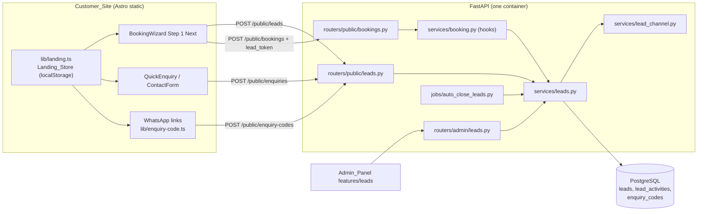

# Design Document: Lead CRM

## Overview

This design adds a Lead record, a small CRM for receptionists, landing attribution with a Channel label, and WhatsApp enquiry codes, on top of the existing booking system. It follows the steering rules: one API container, PostgreSQL, sync SQLAlchemy, Alembic, cron jobs, no new services or dependencies.

Principles:

- **Bookings are untouched.** No new booking status, no change to pricing, availability, double-booking or payments. Leads reference bookings; bookings do not depend on leads.
- **Lead work never breaks a booking.** Every lead write that happens inside a booking request runs in a SAVEPOINT. A failure rolls back only the savepoint, logs an error code, and the booking commits as before.
- **Server decides.** Status transitions, Channel and duplicate handling are computed in `services/leads.py`. Clients send only facts (phone, enquiry fields, attribution).
- **No new dependencies.** Python stdlib (`secrets`, `hashlib`, `urllib.parse`) and the existing frontend libraries only.

### Requirement coverage map

| Requirement | Main design elements |
|---|---|
| R1 data model | `leads`, `lead_activities`, `enquiry_codes` tables; migration `0024` |
| R2 website capture | `POST /api/v1/public/leads`; wizard Step 1 hook; `lead_token` on `BookingCreate`; `link_public_booking` hook |
| R3 quick enquiry forms | `POST /api/v1/public/enquiries`; `QuickEnquiry.tsx`; `ContactForm.tsx`; `/public/contact` kept as compatible alias; data copy in `0024` |
| R4 manual quick-add | `POST /api/v1/admin/leads`; `QuickAddLeadPage` |
| R5 list, filters, uncontacted | `GET /api/v1/admin/leads`; `LeadsPage`; `lead-filter-state.ts` |
| R6 duplicates | partial unique index `uq_leads_prebooking_phone`; `find_or_create_lead` |
| R7 detail, timeline | `GET/PATCH /admin/leads/{id}`; `POST /admin/leads/{id}/activities`; `LeadDetailPage` |
| R8 lead follows booking | `on_booking_status_changed` hook in accept/reject/cancel/review/expire |
| R9 convert to booking | `lead_id` on `AdminBookingCreate`; router state prefill in `BookingFormPage` |
| R10 follow-ups, badge, quick actions | `GET /admin/leads/counts`; `useLeadCounts`; `FollowUpPicker`; `lead-whatsapp.ts` |
| R11 send follow-ups to WhatsApp | `buildFollowUpDigest` in `lead-whatsapp.ts`; `locations.whatsapp_phone` |
| R12 access control | router-level `require_role`; `assert_location_access` in service |
| R13 dashboard | `GET /admin/leads/dashboard`; `LeadDashboardPage` |
| R14 auto-close | `python -m app.jobs.auto_close_leads`; crontab entry |
| R15 privacy, logging | error-code-only logs; privacy policy text; phone helper line |
| R16 reliability | savepoints; additive schema fields; bundle budget |
| R17 landing attribution, Channel | `lib/landing.ts` (Landing_Store); `services/lead_channel.py` (`derive_channel`) |
| R18 enquiry codes | `lib/enquiry-code.ts`; `POST /api/v1/public/enquiry-codes`; `link_enquiry_code` |
| R19 tests | Testing Strategy section |

## Architecture



Layering stays `routers -> services -> models`. `services/booking.py` calls into `services/leads.py` only through three hook functions (`link_public_booking`, `link_admin_booking`, `on_booking_status_changed`); `services/leads.py` never imports booking internals beyond the `Booking` model.

## Data Model

### Migration `0024_create_leads_crm`

One revision (`down_revision = "0023"`) that creates three tables (`leads`, `lead_activities`, `enquiry_codes`), adds one column, and copies contact leads. Models declare the same constraints and indexes (tests build the schema with `create_all`).

#### `leads`

| Column | Type | Notes |
|---|---|---|
| id | bigint identity PK | `pk_leads` |
| location_id | bigint NOT NULL | FK `locations.id` `ON DELETE RESTRICT` (`fk_leads_location_id`) |
| phone | text NOT NULL | 10 digits, CHECK `ck_leads_phone_digits` (`phone ~ '^[6-9][0-9]{9}$'`) |
| name | text NULL | ≤ 120 chars (CHECK) |
| source | text NOT NULL | CHECK `ck_leads_source` on Lead_Source values incl. reserved `instant_form` |
| status | text NOT NULL default `new` | CHECK `ck_leads_status` |
| close_reason | text NULL | CHECK `ck_leads_close_reason` |
| close_reason_text | text NULL | ≤ 500 chars |
| channel | text NOT NULL default `direct` | CHECK `ck_leads_channel` |
| assigned_user_id | bigint NULL | FK `users.id` `ON DELETE SET NULL` |
| follow_up_at | timestamptz NULL | |
| last_activity_at | timestamptz NOT NULL default now() | |
| first_contacted_at | timestamptz NULL | |
| booking_id | bigint NULL | FK `bookings.id` `ON DELETE SET NULL`; unique (`uq_leads_booking_id`) |
| lead_token_hash | text NULL | SHA-256 hex of the Lead_Token, unique (`uq_leads_lead_token_hash`) |
| preferred_date | date NULL | |
| plan_id | bigint NULL | FK `plans.id` `ON DELETE SET NULL` |
| start_time | time NULL | |
| duration_minutes | smallint NULL | |
| guests | smallint NULL | CHECK ≥ 1 |
| message | text NULL | ≤ 2,000 chars |
| utm_source, utm_medium, utm_campaign, utm_content, utm_term | text NULL | ≤ 200 chars each |
| fbclid, gclid | text NULL | ≤ 500 chars |
| landing_path, referrer | text NULL | ≤ 500 chars, query string stripped |
| landed_at | timestamptz NULL | |
| enquiry_code_id | bigint NULL | FK `enquiry_codes.id` `ON DELETE SET NULL` |
| created_at, updated_at | timestamptz | `TimestampMixin` |

Constraints:

- `ck_leads_closed_has_reason`: `status NOT IN ('lost','not_interested') OR close_reason IS NOT NULL` (R1.8).
- `ck_leads_closed_no_follow_up`: `status NOT IN ('won','lost','not_interested') OR follow_up_at IS NULL` (R1.9).
- **`uq_leads_prebooking_phone`**: partial unique index on `(location_id, phone) WHERE status IN ('new','contacted','follow_up')`. This is the race-safe guarantee for R6.4 (see Duplicate handling).

Indexes: `ix_leads_location_status (location_id, status)`, `ix_leads_location_follow_up (location_id, follow_up_at)`, `ix_leads_phone (phone)`, `ix_leads_location_created (location_id, created_at)`. `booking_id` is covered by its unique constraint.

The token is stored hashed: the raw Lead_Token never sits in the database, so a DB leak cannot be used to overwrite leads. This refines R1.2's `lead_token` column name to `lead_token_hash`.

#### `lead_activities`

| Column | Type | Notes |
|---|---|---|
| id | bigint identity PK | |
| lead_id | bigint NOT NULL | FK `leads.id` `ON DELETE CASCADE` |
| type | text NOT NULL | CHECK on `note, call, whatsapp, status_change, follow_up_set, booking_linked, system` |
| text | text NULL | ≤ 2,000 chars (CHECK) |
| data | jsonb NULL | structured detail, e.g. `{"from":"new","to":"contacted"}`, `{"booking_reference":"..."}`, `{"follow_up_at":"..."}` |
| author_user_id | bigint NULL | FK `users.id` `ON DELETE SET NULL`; NULL = customer/system |
| created_at | timestamptz NOT NULL default now() | |

Index `ix_lead_activities_lead_created (lead_id, created_at DESC)`. Append-only (R1.5): the service exposes no update/delete, and there are no update/delete endpoints.

#### `enquiry_codes`

| Column | Type | Notes |
|---|---|---|
| id | bigint identity PK | |
| code | text NOT NULL | uppercase, unique `uq_enquiry_codes_code`, CHECK `^[ABCDEFGHJKMNPQRSTUVWXYZ23456789]{6}$` |
| location_id | bigint NULL | FK `locations.id` `ON DELETE SET NULL`; last branch tapped |
| channel | text NOT NULL | same CHECK values as `leads.channel` |
| utm_*, fbclid, gclid, landing_path, referrer, landed_at | as in `leads` | attribution captured at first registration |
| created_at | timestamptz NOT NULL default now() | |
| last_seen_at | timestamptz NOT NULL default now() | updated on re-registration |

No name, phone or message columns (R18.6). A code is "expired" when `created_at` is older than 30 days (R18.9).

#### `locations.whatsapp_phone`

`ALTER TABLE locations ADD COLUMN whatsapp_phone text NULL` (R11.6). Validated as an Indian mobile in the schema, stored as 10 digits.

#### Data copy: `contact_leads` → `leads` (R3.9–R3.11)

Inside `0024.upgrade()`, after the tables exist:

1. Pick `first_location_id = SELECT id FROM locations WHERE is_active ORDER BY id LIMIT 1` (none → skip copy, nothing to do on an empty DB).
2. For each `contact_leads` row: normalise the phone with the same rule as A2 (strip non-digits; drop a leading `91`/`0` to 10 digits). Rows whose phone is still not a valid 10-digit mobile cannot satisfy the phone CHECK, so they are **skipped** and counted in a migration log line; the original row stays in `contact_leads` (kept read-only for rollback).
3. Insert a Lead with `source='contact_form'`, `status='new'`, `channel='direct'`, `created_at` and `last_activity_at` = original `created_at`, `location_id = first_location_id`.
4. Insert one `note` activity with text = original message (truncated to 2,000) plus a line "Email: <email>" when present, and "Branch unknown (migrated)".
5. The partial unique index applies: a second contact row for the same phone attaches as an extra `note` activity on the first Lead instead of a new Lead (mirrors R6.1).

Downgrade drops the three tables and the column; `contact_leads` is untouched by both directions.

## Backend Components

### File layout

```
apps/api/app/
  models/lead.py                 Lead, LeadActivity, EnquiryCode (+ value tuples)
  schemas/lead.py                public + admin request/response models
  services/lead_channel.py       derive_channel(), normalise attribution (pure)
  services/leads.py              all lead business rules + booking hooks
  routers/public/leads.py        /public/leads, /public/enquiries, /public/enquiry-codes
  routers/admin/leads.py         /admin/leads/...
  jobs/auto_close_leads.py       cron CLI
  core/phone.py                  (existing) add normalise_to_10_digits()
```

Registration: import both routers in `main.py` and `include_router` them next to the existing public/admin routers; add `"app.schemas.lead"` to `_rebuild_schemas()`; add models to `models/__init__.py`. Server settings in `core/config.py` under `# --- Booking lifecycle ---`: `LEAD_AUTO_CLOSE_DAYS: int = Field(0, ge=0, le=365)` (0 = never auto-close, the default) and `LEAD_RESPONSE_ALERT_MINUTES: int = Field(10, ge=1, le=1440)`. They are not editable from the Admin_Panel; changing them means editing `.env` on the server and restarting the API (the cron job reads the value on each run).

### `services/lead_channel.py` (pure)

```python
@dataclass(frozen=True)
class Attribution:
    utm_source: str | None; utm_medium: str | None; utm_campaign: str | None
    utm_content: str | None; utm_term: str | None
    fbclid: str | None; gclid: str | None
    landing_path: str | None; referrer: str | None; landed_at: datetime | None

def clean_attribution(raw: AttributionIn | None) -> Attribution | None
def derive_channel(a: Attribution | None) -> Channel
def manual_channel(source: LeadSource) -> Channel   # whatsapp_ad -> meta_ads, else manual
```

- `clean_attribution` trims, lowercases `utm_source`/`utm_medium` for matching (stored as received, trimmed), strips any query string or fragment from `landing_path` and `referrer`, drops the referrer when its host is a Customer_Site domain (configured `SITE_DOMAINS`, defaults from `CORS_ALLOWED_ORIGINS`), and returns `None` when nothing remains. Malformed input is already rejected by Pydantic; `clean_attribution` never raises.
- `derive_channel` implements R17.9 in order, first match wins. Google domains match `google.<tld>` and `google.co.in` etc. (`host == "google.com"` or host matches `^(www\.)?google\.[a-z.]+$`). Instagram: `instagram.com`, `l.instagram.com`, `www.instagram.com`. Facebook: `facebook.com`, `m.facebook.com`, `l.facebook.com`, `lm.facebook.com`, `www.facebook.com`.
- Pure: no DB, no clock. Property-tested.

### `services/leads.py`

Public functions (all take `db: Session`; none commit unless noted):

| Function | Purpose | Commits |
|---|---|---|
| `capture_website_lead(db, data: WebsiteLeadIn) -> str` | R2.2/2.3/2.7: create or update by token; returns raw Lead_Token | yes |
| `create_enquiry_lead(db, data: EnquiryIn) -> None` | R3: homepage/contact form; honeypot handled in router | yes |
| `register_enquiry_code(db, data: EnquiryCodeIn) -> None` | R18.5 | yes |
| `create_manual_lead(db, data: LeadCreate, actor) -> LeadCreateResult` | R4; returns lead + optional code warning | yes |
| `list_leads / get_lead / update_lead / add_activity / link_enquiry_code` | R5, R7, R18.8 | yes (mutations) |
| `lead_counts(db, actor, location_id, now)` | R5.9, R10.1 | no |
| `dashboard(db, actor, location_id, date_from, date_to)` | R13 | no |
| `close_stale_leads(db, now) -> int` | R14 | yes |
| **Hooks** (no commit, caller's transaction, savepoint inside): | | |
| `link_public_booking(db, booking, lead_token, contact)` | R2.9/2.10 | no |
| `link_admin_booking(db, booking, lead_id, actor)` | R9.3 | no |
| `on_booking_status_changed(db, booking, new_status)` | R8 | no |

Internal helpers:

- `_find_or_create_lead(db, *, location_id, phone, source, channel, fields, attribution, actor) -> Lead` — duplicate rule (below).
- `_transition(db, lead, to_status, *, actor, reason=None, reason_text=None, system_text=None)` — the single place that changes `status`; writes `status_change`, maintains `follow_up_at`/`first_contacted_at`, enforces close-reason, and rejects manual `booked`/`won` (R7.7) when `actor` is a user-initiated update.
- `_add_activity(db, lead, type, text, data, author_id)` — inserts and sets `last_activity_at` (R1.7).
- `_lead_savepoint(db, code)` — context manager:

```python
@contextmanager
def _lead_savepoint(db: Session, code: str):
    sp = db.begin_nested()
    try:
        yield
        sp.commit()
    except Exception:          # noqa: BLE001 — lead work must never break bookings
        sp.rollback()
        log.error("lead_hook_failed", code=code)   # error code only, no PII
```

#### Status rules

| Trigger | From | To | Activity |
|---|---|---|---|
| Lead created (no follow-up) | — | `new` | `system` "Lead created via <source>" |
| Manual create with follow-up | — | `follow_up` | `follow_up_set` |
| `call`/`whatsapp` activity | `new` | `contacted` | `status_change` (+ sets `first_contacted_at`) |
| Follow-up set | `new`/`contacted` | `follow_up` | `follow_up_set` |
| Manual change | any open (not `booked`) | `contacted`/`follow_up`/`not_interested`/`lost` | `status_change` |
| Manual change to `booked`/`won` | any | — | rejected `422` |
| Booking linked (public or admin, pending) | open | `booked` | `booking_linked` |
| Booking linked, created `accepted` | open | `won` | `booking_linked` + `status_change` |
| Linked booking accepted | `booked`/`follow_up` | `won` | `status_change` |
| Linked booking rejected/expired/cancelled | `booked`/`won` | `follow_up`, `follow_up_at = now` | `system` "Booking <ref> <outcome>" |
| Linked booking reinstated (expired → pending) | `follow_up` | `booked` | `status_change` |
| Auto-close | `new`/`contacted`/`follow_up` | `lost` (`no_response`) | `system` |

Closing (`won`, `lost`, `not_interested`) clears `follow_up_at` (R1.9). `first_contacted_at` is set on the first `call`/`whatsapp` activity or the first status change away from `new` by a user (R7.4).

Note on reinstatement: the only reinstate path in the code is `review_booking` (expired → pending, admin). Rejected and cancelled bookings cannot be reinstated today, so R8.3 applies to `review_booking` only. No booking rule is changed.

Note on `won` (R8.7): once `won`, only a later cancel/reject of the same booking moves the lead back to `follow_up`; booking edits never touch the lead.

#### Duplicate handling (R6)

```
_find_or_create_lead(location_id, phone, ...):
  1. SELECT pre-booking open lead (status in new/contacted/follow_up) for (location_id, phone)
       FOR UPDATE
     found -> attach: add `system` activity "Repeat enquiry via <source>",
              fill only empty enquiry fields, keep attribution if already set,
              return it
  2. INSERT new lead ... ON CONFLICT ON (location_id, phone) WHERE status IN (...)
       DO NOTHING RETURNING id
     inserted -> return it
     conflict (a concurrent request won) -> go to step 1 (re-select, now finds it)
```

- The partial unique index makes step 2 race-safe: two concurrent creates for the same phone and branch can only produce one pre-booking lead (R6.4). Step 2 uses `sqlalchemy.dialects.postgresql.insert(...).on_conflict_do_nothing(index_elements=["location_id","phone"], index_where=...)`.
- A `booked` lead is open (R6.1 history view) but is **not** in the unique index, because a customer can hold one booked lead and enquire again for another date. For a **new enquiry** the lookup prefers a pre-booking lead; if none exists but a `booked` lead exists, the enquiry attaches to the `booked` lead as a `system` activity (no new lead). For a **new booking** (no token) when the only open lead is already `booked` with another booking, a new lead is created and linked (unique index does not block, because the new lead is created directly as `booked`).
- Closed leads never match; a new lead is created (R6.2).
- Public endpoints return the same response whether attached or created (R6.5).

#### Booking hooks (exact integration points in `services/booking.py`)

| Function | Insert point | Hook call |
|---|---|---|
| `create_customer_booking` | after `write_booking_event(... "created" ...)` (≈ line 720), before `db.commit()` (≈ 731), inside the reference-retry loop | `leads.link_public_booking(db, booking, data.lead_token, contact)` |
| `create_admin_booking` | after the optional payment row (≈ 971), before `db.commit()` (≈ 981) | `if data.lead_id: leads.link_admin_booking(db, booking, data.lead_id, actor)` |
| `accept_booking` | after `write_booking_event("accepted")` (≈ 1469), before commit (≈ 1477) | `leads.on_booking_status_changed(db, booking, "accepted")` |
| `reject_booking` | after event, before commit (≈ 1495) | `... "rejected"` |
| `cancel_booking` | after event, before commit (≈ 1575) | `... "cancelled"` |
| `review_booking` | after event, before commit (≈ 1538) | `... "pending"` |
| `expire_pending_bookings` | inside the loop, after each `write_booking_event("expired")`, before the single commit (≈ 1736) | `... "expired"` (one savepoint per booking) |

Each hook wraps its work in `_lead_savepoint`, so a failing lead update rolls back only its savepoint and the booking statement still commits (R2.11, R8.5, R16.1). `on_booking_status_changed` is a no-op when no lead has `booking_id = booking.id` (one indexed lookup via `uq_leads_booking_id`). In `create_customer_booking`, an `IntegrityError` retry does a full `db.rollback()`; the hook runs again inside the next loop iteration, so the link is never lost or duplicated. A slot `409` raises before commit, so no lead is linked (the Step 1 lead stays `new`, which is correct: the customer may pick another slot).

`link_public_booking(db, booking, token, contact)`:
1. If `token` resolves (hash match) to an open, not-yet-linked lead at the booking's branch → link it, update name/phone from the booking when they changed, `_transition → booked`, `booking_linked` activity with the booking reference.
2. Otherwise `_find_or_create_lead(source='website', phone=booking phone, channel from the lead request attribution if given else `direct`)`, link, `booked`.

`link_admin_booking` validates that the lead exists, is in the booking's branch, has no booking, and is open; a validation failure is raised **before** the booking is created (checked at the top of `create_admin_booking`), returning `422`, so the user sees why the link was refused. Once validated, the link itself runs in a savepoint like the other hooks. Status: `won` if the booking was created `accepted` (admin creates are always `accepted` today), else `booked`.

### Schemas (`schemas/lead.py`)

Public (no `extra` fields allowed: `model_config = ConfigDict(extra="ignore")` so unexpected client fields such as status/notes are dropped, R2.13):

```python
class AttributionIn(BaseModel):       # all optional, max_length enforced
    utm_source: str | None = Field(None, max_length=200)  # ... utm_* likewise
    fbclid: str | None = Field(None, max_length=500)
    gclid: str | None = Field(None, max_length=500)
    landing_path: str | None = Field(None, max_length=500)
    referrer: str | None = Field(None, max_length=500)
    landed_at: datetime | None = None

class WebsiteLeadIn(BaseModel):
    lead_token: str | None = Field(None, max_length=64)
    location_id: int
    phone: str                         # validated with normalise_to_10_digits -> 422
    name: str | None = Field(None, max_length=120)
    preferred_date: date | None = None
    plan_id: int | None = None
    start_time: time | None = None
    duration_minutes: int | None = Field(None, ge=1, le=1440)
    guests: int | None = Field(None, ge=1, le=200)
    attribution: AttributionIn | None = None

class LeadTokenOut(BaseModel):  lead_token: str
class EnquiryIn(BaseModel):     source: Literal["homepage_form","contact_form"]; location_id; phone; name (required, ≤120);
                                preferred_date?; message? (≤2000); email? (EmailStr, optional); website?: str (honeypot); attribution?
class EnquiryCodeIn(BaseModel): code: str (pattern); location_id: int | None; attribution: AttributionIn | None
class OkOut(BaseModel):         message: str
```

Malformed attribution (R17.8): each request model that carries `attribution` uses a `field_validator("attribution", mode="wrap")` that catches the nested `ValidationError` and returns `None`, so bad attribution is dropped and the lead is still saved.

`BookingCreate` gains `lead_token: str | None = Field(None, max_length=64)` (R16.2). `AdminBookingCreate` gains `lead_id: int | None = None`.

Admin:

```python
class LeadCreate(BaseModel):  phone; source (manual sources only); name?; location_id; note? (≤2000); follow_up_at?; enquiry_code?
class LeadUpdate(BaseModel):  status?; close_reason?; close_reason_text?; assigned_user_id? (nullable explicit); follow_up_at? (nullable explicit); name?
class ActivityCreate(BaseModel): type: Literal["note","call","whatsapp"]; text? (≤2000)
class LinkCodeIn(BaseModel):  code: str
class LeadListItem / LeadRead / ActivityRead / LeadCounts / LeadDashboard / LeadCreateResult(lead: LeadRead, warning: str | None, code_used_by_lead_id: int | None)
```

`LeadRead` includes `minutes_since_created`, `is_uncontacted` (computed in the service from `LEAD_RESPONSE_ALERT_MINUTES`), `booking_reference`, `assigned_user_name`, attribution summary with `referrer_domain` and `has_fbclid`/`has_gclid` booleans (raw click IDs are not returned to the UI; they add no value there), and `same_phone_leads: list[LeadBrief]` limited to branches the actor may access (R6.3).

### Public API (`routers/public/leads.py`, prefix `/api/v1/public`)

| Method + path | Limit | Body → Response | Notes |
|---|---|---|---|
| `POST /leads` | `10/minute` | `WebsiteLeadIn` → `201 LeadTokenOut` | R2. 422 on invalid phone or unknown location |
| `POST /enquiries` | `5/minute` | `EnquiryIn` → `201 OkOut` | R3. Honeypot `website` non-empty → `201 OkOut`, nothing stored |
| `POST /enquiry-codes` | `10/minute` | `EnquiryCodeIn` → `204` | R18.5. Upsert on `code`: first insert stores attribution + channel; conflict updates `location_id`, `last_seen_at` only |
| `POST /contact` (existing) | `5/minute` | `ContactCreate` (email now optional, `location_id` optional) → `ContactResult` | Kept for compatibility; now calls `create_enquiry_lead(source="contact_form")`, using `location_id` or the first active branch with note "branch unknown". The new Contact page form posts to `/enquiries`. |

These routers are public (no `require_role`), registered explicitly in `main.py`, listed in the public allowlist section of `docs/` (R12.6). They return no lead data except the token and a fixed message (R15.3).

Lead_Token: `secrets.token_urlsafe(24)` (192 bits, A3). Stored as `sha256(token).hexdigest()`. A token is accepted only when the lead is open, has no booking, and was created within the last 7 days; otherwise R2.7 applies (new lead via duplicate rule, new token returned).

### Admin API (`routers/admin/leads.py`)

Router: `APIRouter(prefix="/api/v1/admin", tags=["admin-leads"], dependencies=[Depends(require_role(*LEAD_ACCESS)), Depends(check_origin)])` where `LEAD_ACCESS = ("admin", "receptionist")` (R12.1; staff get 403). Staff routers use `STAFF_ACCESS = ("admin", "staff", "receptionist")`, so a receptionist has every staff permission (R12.8). Branch access enforced in the service with `assert_location_access` (R12.2/12.3).

| Method + path | Purpose | Notes |
|---|---|---|
| `GET /leads?location_id&status&source&channel&assigned_user_id&follow_from&follow_to&created_from&created_to&q&limit&offset` | R5 list | multi-value `status`, `source`, `channel`; `q` ≥ 3 chars (name ILIKE or phone digits LIKE); sort: section rank, then key time, then id |
| `GET /leads/counts?location_id` | R5.9, R10.1 | `{uncontacted, overdue, due_today}`; three indexed `COUNT`s |
| `GET /leads/follow-ups?location_id` | R11 digest | overdue + due-today leads with last note (≤ 60 chars) for the WhatsApp message |
| `POST /leads` | R4 quick-add | returns `LeadCreateResult` (warning for unknown/expired code, notice if code used elsewhere) |
| `GET /leads/{id}` | R7 detail | includes timeline (newest first) and same-phone leads |
| `PATCH /leads/{id}` | R7.5 | status / reason / assignment / follow-up / name; 422 rules |
| `POST /leads/{id}/activities` | R7.2 | `note`/`call`/`whatsapp` |
| `POST /leads/{id}/enquiry-code` | R18.8 | link a code to an existing lead |
| `GET /leads/dashboard?location_id&date_from&date_to` | R13 | **admin only**: route-level `Depends(require_role("admin"))` in addition to the router dependency (R12.5) |
| `GET /leads/assignable-users?location_id` | R12.4 | active users with access to the branch (staff of that branch + admins) |

List ordering (R5.1, R5.8): computed in SQL with a `CASE` "section" column:

1. Uncontacted_New_Lead (`status='new' AND first_contacted_at IS NULL AND created_at < now - LEAD_RESPONSE_ALERT_MINUTES`) — oldest first.
2. Overdue (`follow_up_at < now`, open) — oldest follow-up first.
3. Due_Today (`follow_up_at` between now and end of today IST) — soonest first.
4. New with no follow-up (not yet past the alert threshold) — newest first.
5. Everything else — `last_activity_at DESC`.

Then `id DESC` for stability. When explicit filters are applied (status, dates, search), the same section ordering is kept so the screen behaves the same.

Updated existing endpoints:
- `PATCH /api/v1/admin/locations/{id}` (`LocationHoursUpdate`) gains optional `whatsapp_phone` (validated Indian mobile, `null` clears); `LocationAdminRead` and public `LocationRead` gain `whatsapp_phone`.
- `POST /api/v1/admin/bookings` (`AdminBookingCreate`) gains optional `lead_id`.
- `POST /api/v1/public/bookings` (`BookingCreate`) gains optional `lead_token`.

### Dashboard queries (R13)

All in SQL, filtered by `location_id` (or all branches when the admin selects "All") and `created_at` IST date range:

- Leads per day by source / by channel: `GROUP BY (created_at AT TIME ZONE 'Asia/Kolkata')::date, source|channel`.
- Totals and won per source / channel: `COUNT(*)`, `COUNT(*) FILTER (WHERE status='won')`.
- First response: `AVG(first_contacted_at - created_at)` and `percentile_cont(0.5) WITHIN GROUP (ORDER BY first_contacted_at - created_at)` for leads with `first_contacted_at`.
- Close reasons: `GROUP BY close_reason` for `lost`/`not_interested`.
- Campaigns: `GROUP BY utm_campaign` where not null, total and won.
- WhatsApp code share: `COUNT(*) FILTER (WHERE enquiry_code_id IS NOT NULL) / COUNT(*)` for sources `whatsapp`, `whatsapp_ad`.

Conversion rate = won ÷ total, returned as integer counts; the UI formats the percentage (no floats stored).

### Auto-close job (R14)

`apps/api/app/jobs/auto_close_leads.py` mirrors `expire_pending.py`:

```python
def main() -> None:
    db = SessionLocal()
    try:
        closed = leads_service.close_stale_leads(
            db, now=datetime.now(UTC), days=settings.LEAD_AUTO_CLOSE_DAYS
        )
        log.info("auto_close_leads_completed", closed=closed)   # count only
    finally:
        db.close()
```

`close_stale_leads(db, now, days)`: the job passes `settings.LEAD_AUTO_CLOSE_DAYS`, read when the job process starts, i.e. each run (R14.8). If `days == 0` (the default) it returns `0` without querying (R14.7). Otherwise `SELECT ... FOR UPDATE SKIP LOCKED` leads with status in (`new`,`contacted`,`follow_up`), `last_activity_at < now - days`, and (`follow_up_at IS NULL OR follow_up_at < now`); `_transition(... "lost", reason="no_response", system_text="Closed automatically after N days without activity")`; one commit. A second run finds nothing (the transition writes an activity, which also refreshes `last_activity_at`). `booked` leads are excluded by the status filter (R14.3).

Crontab (`deploy/cron/crontab`), daily 03:00 IST:

```
30 21 * * * cd /opt/cinematic/New_Application/deploy && docker compose exec -T api python -m app.jobs.auto_close_leads >> /var/log/cc/leads.log 2>&1
```

### Logging and privacy (R15)

- Lead services log only codes and counts: `lead_hook_failed code=link_public_booking`, `lead_created source=website channel=meta_ads location_id=2`, never phone, name, note, message, IP or token.
- Phone in admin responses only after `assert_location_access`.
- No lead data leaves the system; there are no outbound calls in this feature.

## Frontend: Customer_Site (`apps/web`)

### New modules

| File | Purpose |
|---|---|
| `src/lib/landing.ts` | Landing_Store: `captureLanding(url, referrer, now)`, `readLanding(now)`; key `cc.landing.v1` in `localStorage` |
| `src/lib/enquiry-code.ts` | `getOrCreateEnquiryCode(now)`; key `cc.enquiryCode.v1` `{code, created_at}`; alphabet `ABCDEFGHJKMNPQRSTUVWXYZ23456789`, `crypto.getRandomValues` |
| `src/lib/lead-capture.ts` | `sendStep1Lead(draft, location)`: fire-and-forget `POST /public/leads`, keeps `cc.leadToken` in `sessionStorage`; `getLeadToken()` |
| `src/lib/whatsapp.ts` | `buildWhatsappLink(location, code)`: number = `whatsapp_phone ?? phone`, message with greeting + "Enquiry code: XXXXXX"; `registerEnquiryCode(code, locationId)` using `fetch(..., { keepalive: true })` |
| `src/lib/phone.ts` (existing) | add `normaliseIndianMobile(raw): string \| null` (10 digits) |
| `src/components/booking/QuickEnquiry.tsx` | homepage form (React island, `client:visible`) |
| `src/components/booking/ContactForm.tsx` (existing) | add branch select, optional email, honeypot, field errors; posts to `/public/enquiries` |

`landing.ts` rules (R17):
- On every page load (bundled `<script>` in `Base.astro`, so it runs on all pages): parse `utm_*`, `fbclid`, `gclid` from `location.search`; referrer = `document.referrer` unless same host.
- Campaign params present → overwrite the store. Store empty (or older than 30 days) → write whatever is present (may be only a referrer, or only the landing path for direct). Otherwise leave it.
- Stored `landing_path` = `location.pathname` (no query). Stored `referrer` = `origin + pathname` (no query).
- All storage access wrapped in `try/catch`; when storage is unavailable, `readLanding` returns the current page's attribution (R17.6).
- No PII ever enters the store (inputs are URL params and referrer only).

Bundled vs inline script: the current floating-WhatsApp script in `Base.astro` is `is:inline` with `define:vars`. It is converted to a normal bundled `<script>` that imports `landing.ts`, `enquiry-code.ts` and `whatsapp.ts`, reading the API base from `import.meta.env.PUBLIC_API_BASE_URL`. Markup and behaviour stay the same; only the link building changes. Astro bundles and dedupes it; added size is a few KB.

### Booking wizard changes (`BookingWizard.tsx`)

- Next button `onClick`: when `step === 1`, call `void sendStep1Lead(draft, location)` **before** `setStep(...)`. `sendStep1Lead` never throws (internal `.catch`), and is not awaited (R2.5, R2.6).
- `submit()`: add `lead_token: getLeadToken() ?? undefined` to the `createBooking` body (R2.8).
- Under the phone input: helper line "We'll use this number to help with your booking." (R15.5).
- No other wizard behaviour changes.

`sendStep1Lead` body: location id, phone, name, date, plan id, start time / duration (open mode) or the slot's start/duration (slot mode, taken from the selected slot), guests (adults + kids), `lead_token`, and `attribution: readLanding()`. Duplicate sends on repeated Next taps are harmless (same token, update).

### WhatsApp links (R18)

- Floating WhatsApp panel (`Base.astro`) and branch links (`LocationList.tsx`) use `buildWhatsappLink`. Message: `Hi Cinematic Celebration (<branch>)! I'd like to know more about booking a celebration. 🎬\nEnquiry code: W4K7XQ`.
- On tap: `registerEnquiryCode(code, locationId)` (keepalive fetch, JSON body `{code, location_id, attribution}`), then the normal `target="_blank"` navigation proceeds. No `preventDefault`, so WhatsApp opens even if the request fails (R18.4).
- `fetch` with `keepalive` is used instead of `navigator.sendBeacon` because a JSON body to another origin needs a CORS-preflighted request, which `sendBeacon` does not support reliably. The API's CORS allowlist already includes the site origin.

### Bundle impact

New code on `/book`: `landing.ts` + `lead-capture.ts` (< 3 KB gzipped). Homepage adds `QuickEnquiry` (< 4 KB). Booking page stays under 150 KB gzipped (R16.4); verified in the build step of the tasks.

### Privacy policy

`pages/privacy-policy.astro` adds a paragraph: contact details entered in the booking form or enquiry forms may be stored and used to contact the customer about their enquiry; WhatsApp links include a short enquiry code that helps us understand how visitors found us; no message content is collected by the website (R15.4).

## Frontend: Admin_Panel (`apps/admin`)

### Feature folder `src/features/leads/`

| File | Purpose |
|---|---|
| `types.ts` | Lead, Activity, enums, labels (source/status/channel/close reason) |
| `lead-queries.ts` | TanStack hooks: `useLeads`, `useLead`, `useLeadCounts` (`refetchInterval: 60_000`, `refetchOnWindowFocus: true`), `useFollowUps`, `useCreateLead`, `useUpdateLead`, `useAddActivity`, `useLinkEnquiryCode`, `useLeadDashboard`, `useAssignableUsers` |
| `lead-schema.ts` | zod schemas mirroring the API (phone normalisation, note ≤ 2000, close reason required when closing) |
| `lead-filter-state.ts` | sessionStorage filters (`cc.admin.leadListFilters`), same pattern as `list-filter-state.ts` (R5.5) |
| `lead-whatsapp.ts` | `normalisePhone`, `telHref`, `customerWhatsappUrl(lead, branchName)`, `buildFollowUpDigest(leads, branch)` with 3,500-char cap and "+N more in admin" (R11.2/11.5) |
| `follow-up-presets.ts` | IST preset computation (1 h, 7 pm today/tomorrow if past, tomorrow 11 am, +3 days) |
| `LeadsPage.tsx` | sections (Not contacted, Overdue, Due today, New, Others); filters; cards < 768 px, table ≥ 768 px; "Send today's follow-ups" button |
| `LeadCard.tsx`, `LeadTable.tsx`, `LeadStatusBadge.tsx`, `ChannelBadge.tsx` | list rendering |
| `QuickAddLeadPage.tsx` | route `/leads/new`; phone autofocus, `inputMode="numeric"`, source default WhatsApp, enquiry code field |
| `LeadDetailPage.tsx` | route `/leads/:leadId`; contact, quick actions, status/reason/assign/follow-up editors, enquiry-code link, attribution, same-phone leads, timeline, "Create booking" |
| `ActivityTimeline.tsx`, `AddActivityForm.tsx`, `FollowUpPicker.tsx`, `CloseLeadDialog.tsx`, `LogContactPrompt.tsx` | detail-page parts |
| `LeadDashboardPage.tsx` | route `/leads/dashboard` (admin) |
| `Toast.tsx` | minimal local toast (there is no shared toast; moved to `components/` only if a second feature needs it, per structure.md) |

### Routing and navigation

- `routes/router.tsx`: add `leads`, `leads/new`, `leads/:leadId` (all users) and `leads/dashboard` wrapped in `<ProtectedRoute requiredRole="admin">` (declared before `leads/:leadId` so the static path wins).
- `AppLayout.tsx`: add a **Leads** `NavLink` after Bookings with a badge component `LeadNavBadge` showing two pills: red uncontacted count, amber overdue + due-today count (R5.9, R10.1). Add **Lead dashboard** for admins next to Analytics (R16.6). Existing entries unchanged.

### Location data

`LocationGate` maps `phone` and `whatsapp_phone` into `LocationOption` so the Leads page can build the branch WhatsApp link without another request. `features/catalog/LocationSettings.tsx` `LocationRow` gains a "Branch WhatsApp number" input (optional, validated) saved through the existing `useUpdateLocationHours` mutation.

### Convert to booking (R9)

`LeadDetailPage` → `navigate('/bookings/new', { state: { fromLead: { leadId, initial } } })`, where `initial` is `Partial<BookingCreateInput>` (name, phone, location, date, plan, guests, start time). `BookingFormPage` `CreateBooking` reads `useLocation().state?.fromLead` (react-router), passes `initial` to `BookingForm` (already supported), shows "Creating booking for lead <name/phone>", and adds `lead_id` to the create body. After success it shows the existing success panel plus a "Back to lead" link. Direct visits to `/bookings/new` behave as today (R9.6).

### Quick actions (R10.3/10.4)

Tapping Call or WhatsApp opens the link and shows `LogContactPrompt` ("Log this call?" one-tap button) so the activity is recorded with one more tap; dismissing logs nothing.

## Error Handling

| Situation | Behaviour |
|---|---|
| Lead request from wizard fails / times out | Ignored silently; wizard continues (R2.6) |
| Invalid phone on public lead/enquiry | `422` with field error; enquiry form shows it and keeps values (R3.6) |
| Honeypot filled | `201` normal message, nothing stored (R3.7) |
| Rate limit exceeded | `429` (existing slowapi handler) |
| Unknown/expired/closed Lead_Token | New lead via duplicate rule, new token returned (R2.7) |
| Lead hook raises during booking/accept/reject/cancel/review/expire | Savepoint rollback, `lead_hook_failed` error code logged, booking operation completes (R2.11, R8.5, R16.1) |
| `lead_id` invalid on admin create (other branch, already linked, closed, missing) | `422` before the booking is created |
| Manual status `booked`/`won` | `422` |
| Close without reason | `422` |
| Assign to user without branch access | `422` (R12.4) |
| Staff accessing another branch's lead | `403` (R12.3) |
| Staff on dashboard | `403` (R12.5) |
| Enquiry code unknown/expired in quick-add or link | Lead saved; response `warning` shown in UI (R18.9) |
| Enquiry code already linked to another lead | Linked anyway; response includes the other lead id; UI shows notice (R18.10) |
| Branch has no WhatsApp/phone number | Digest button disabled with hint (R11.4) |
| No follow-ups due | Digest button disabled, "No follow-ups due" (R11.7) |
| Storage unavailable (web) | Current-page attribution only; no enquiry-code reuse; everything still works |

## Correctness Properties

These are checked with property-based tests (Hypothesis on the API, fast-check is **not** added to the web — web properties are covered with table-driven Vitest cases to avoid a new dependency).

1. **Channel determinism and priority** — for any attribution, `derive_channel` returns exactly one Channel; adding `fbclid` to any attribution yields `meta_ads`; adding `gclid` without `fbclid` (and no Meta UTM) yields `google_ads`; empty attribution yields `direct`. (R17.9)
2. **Attribution sanitising** — for any input string, the cleaned `landing_path` and `referrer` contain no `?` or `#`, and length limits hold. (R17.7)
3. **Phone normalisation** — for any 10-digit valid mobile `m`, every formatting variant (`+91 m`, `0m`, `91-m`, spaces/dashes) normalises to `m`; any string that does not normalise is rejected. (A2, R4.4)
4. **At most one pre-booking lead per phone and branch** — for any sequence of create/attach/close operations (sequential and concurrent), the count of leads with status in (`new`,`contacted`,`follow_up`) for a `(location, phone)` is ≤ 1. (R6.1, R6.4)
5. **Activities are append-only and `last_activity_at` is monotonic** — after any sequence of operations, the activity count never decreases and `last_activity_at` equals the latest activity time. (R1.5, R1.7)
6. **Status invariants** — after any sequence of operations: closed leads have no `follow_up_at`; `lost`/`not_interested` have a close reason; `booked`/`won` leads have a `booking_id`. (R1.8, R1.9, R7.7)
7. **Booking outcome independence** — for any booking operation, injecting a failure into the lead hook leaves the booking's final status, events and payments identical to a run without leads. (R16.1)
8. **Auto-close idempotence** — running `close_stale_leads` twice at the same `now` closes nothing the second time; leads with a future follow-up or status `booked` are never closed. (R14)
9. **Follow-up digest bound** — for any list of leads, the digest is ≤ 3,500 characters and, when truncated, ends with `+N more in admin` where N is the number omitted. (R11.5)

## Testing Strategy

API (pytest, real PostgreSQL via the existing testcontainers fixtures, `pytestmark = pytest.mark.integration`):

| File | Covers (R19 case numbers) |
|---|---|
| `tests/unit/test_lead_channel.py` | Channel rules one case per channel + properties 1–2 (19) |
| `tests/unit/test_phone_normalise.py` | property 3 |
| `tests/integration/test_leads_public.py` | Step 1 capture + token update (2); invalid phone, ignored client fields (3); enquiries, honeypot, 429 (14); enquiry codes register/re-register/422/429 (21) |
| `tests/integration/test_leads_booking_link.py` | link with token (4); without token (5); hook failure keeps booking (6, property 7, via monkeypatching `leads._apply_link` to raise); accept/reject/cancel/expire/review transitions (7); admin create without lead / convert (8) |
| `tests/integration/test_leads_rules.py` | duplicates incl. concurrent creates with two sessions/threads (9, property 4); close rules (10, property 6); contact activity → contacted + first_contacted_at, no edit/delete endpoints (11, property 5); uncontacted rule (22) |
| `tests/integration/test_leads_access.py` | 401/403/200 matrix, dashboard admin-only, assignment validation (12) |
| `tests/integration/test_auto_close_leads.py` | stale close (with `days=14`), booked/future follow-up kept, second run no-op, `days=0` closes nothing (13, property 8) |
| `tests/integration/test_leads_migration.py` | contact_leads copy: run the copy SQL function against seeded rows (15) |
| `tests/integration/test_leads_logging.py` | capture logs with `caplog`/structlog capture; assert phone and name absent (16) |
| `tests/integration/test_leads_enquiry_code.py` | quick-add with code copies attribution/channel; unknown/expired warning; reused code notice (21) |

The data-copy logic lives in a plain function `copy_contact_leads(connection)` in the migration module's helper (`app/services/lead_migration.py`) so it can be tested against the test database; the Alembic revision calls it.

Web (Vitest, jsdom): `landing.test.ts` (20), `enquiry-code.test.ts` and `whatsapp.test.ts` (23), `lead-capture.test.ts` + `BookingWizard.test.tsx` additions (17), `QuickEnquiry.test.tsx`, `ContactForm.test.tsx`.

Admin (Vitest): `lead-whatsapp.test.ts` (digest format, cap, disabled states, property 9 table cases), `lead-schema.test.ts` (phone normalisation), `LeadsPage.test.tsx` (section ordering, uncontacted label, empty state), `QuickAddLeadPage.test.tsx`, `LeadDetailPage.test.tsx` (close requires reason, log-contact prompt), `AppLayout.test.tsx` (dashboard nav hidden from staff, badge) (18).

Done when `ruff`, `pytest`, `eslint`, `vitest` pass and the web build reports the booking page under 150 KB gzipped (R19.24, R16.4).

## Rollout

1. Merge; on the droplet: `pg_dump`, `git pull`, build api, `alembic upgrade head` (0024), `up -d api`, healthz.
2. Install the new crontab line (`crontab deploy/cron/crontab` after review).
3. Redeploy admin and web on Cloudflare Pages.
4. In admin, add each branch's WhatsApp number (Catalog → Locations).
5. Server `.env`: `LEAD_AUTO_CLOSE_DAYS=0` (never auto-close) and `LEAD_RESPONSE_ALERT_MINUTES=10` unless you want different values. The auto-close cron entry is installed anyway; with 0 it does nothing.
6. Owner actions (no code): add UTM tags to Meta ad URLs; set the Google Business Profile website link to `https://cinematiccelebration.in/?utm_source=google&utm_medium=gbp`.

Rollback: `alembic downgrade 0023` drops the new tables and column (contact_leads untouched); redeploy the previous web/admin builds. Bookings are unaffected either way.

## Knowledge Documentation

Deferred by the owner: this spec builds the feature only. A later, separate piece of work writes plain-language knowledge pages under `docs/knowledge/` (starting with `leads.md`: lifecycle, what each status/source/channel means, which screen or event sets each field and when, the enquiry-code flow, the daily job, settings, FAQ), then other areas one at a time. No knowledge-document task is included in this spec's task list.

## Out of Scope (from requirements)

Meta events, Lead Ads webhook, WhatsApp Cloud API, email/SMS reminders, consent banner, lead back-fill, merge/delete/import/export, offer-for-number, exit-intent/timed bar, chat widget, OTP, call tracking.
